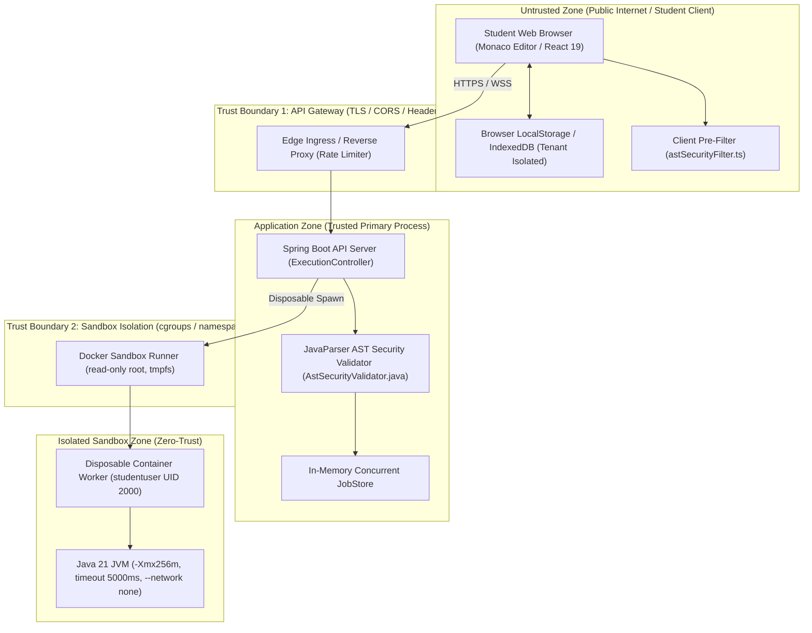

# OOPS LAB — Security Architecture Inventory
**Audit Stage:** Stage A — Repository Discovery & Architecture Mapping  
**Date:** 2026-11-06  
**Auditor:** Principal Security Architect & Security Engineering Team  

---

## 1. System Components & Technology Stack

| Layer | Component | Technology / Framework | Security Role |
|---|---|---|---|
| **Frontend UI** | Web Application | React 19, TypeScript, Vite, Tailwind CSS, Monaco Editor, Zustand | Presentation, code editing, client-side AST inspection, localized IndexedDB state |
| **API Gateway** | Reverse Proxy / Ingress | Vite Dev Server (Staging) / Nginx (Production) | Ingress routing, TLS termination, CORS policy, rate limiting |
| **Backend API** | REST API Service | Java 21 LTS, Spring Boot 3.3.4, JavaParser 3.26.1 | REST request handling, static AST pre-screening, job dispatch |
| **Execution Engine** | Client-Side JVM | TypeScript (`javaVirtualMachine.ts`) | Deterministic zero-trust in-browser JDI simulation |
| **Worker Sandbox** | Container Worker | Docker (`eclipse-temurin:21-jdk-alpine`), non-root `studentuser` (UID 2000) | Hardened execution isolation for untrusted student Java code |
| **Local Storage** | Client Data Persistence | IndexedDB / LocalStorage (`oops_lab_storage:*`) | Local-first student session and project storage |

---

## 2. Security Architecture Diagram & Trust Boundaries

---

## 3. Sensitive Data Flows & Trust Boundaries

1. **Untrusted Student Code Ingestion (Flow 1):**  
   Student enters Java source code into Monaco Editor $\rightarrow$ Code passes through client-side `astSecurityFilter.ts` $\rightarrow$ Dispatched via `POST /api/v1/execution/run` $\rightarrow$ Passes `AstSecurityValidator.java` $\rightarrow$ Dispatched to isolated sandbox container.
2. **Session & Authentication Token Ingestion (Flow 2):**  
   Guest entry or login credentials $\rightarrow$ Serialized in client store $\rightarrow$ Validated on server API with HTTPOnly cookies / Bearer headers.
3. **Execution Trace Feedback (Flow 3):**  
   JDI execution events generated in sandbox $\rightarrow$ Sanitized $\rightarrow$ Transmitted to browser visualizer canvas with strict XSS encoding.

