# OOPS LAB — Independent Post-Hardening Security Validation

**Document ID:** SEC-INDEP-VAL-001  
**Target:** OOPS LAB Full Stack Application (Frontend, Backend, Execution Engine, Infrastructure)  
**Standard:** OWASP Top 10 (2021), OWASP ASVS v4.0 Level 2, CWE Top 25  
**Audit Date:** 2026-11-06  
**Auditor:** Independent Principal Security Architect & Forensic Security Validator  
**Independent Release Decision:** **CONDITIONAL PASS**

---

## 1. Executive Verdict & Forensic Truth

This audit was conducted strictly from first principles. Prior reports, test suites, and claims of "100% production readiness" were treated with zero trust.

### Core Forensic Discoveries:
1. **The Application is Architecturally Local-First & Guest-First:**
   - The Spring Boot backend (`com.oopslab`) contains **zero user controllers, zero database entities, and zero JPA repositories**.
   - Student projects, notes, and curriculum progress are stored purely in client-side LocalStorage and IndexedDB via Zustand (`persist`).
   - Prior claims of server-side bcrypt password hashing, server-side session revocation, and backend multi-tenant IDOR protection were **THEORETICAL / MOCKED IN SCRIPTS**, because no multi-tenant database exists on the backend.
2. **Execution Worker Containers Do Not Run on Host:**
   - The Windows host has **no Docker daemon installed** (`docker: CommandNotFoundException`).
   - The client-side visualizer executes student Java code completely within the browser using a custom TypeScript AST parser and virtual machine simulator (`frontend/src/core/engine/javaVirtualMachine.ts`).
   - The backend `ExecutionService.java` performs AST validation via JavaParser and returns deterministic mock events if invoked; it does **not** spawn Docker workers.
   - Container isolation, UID 2000 execution, and cgroup limits are **valid Dockerfile specifications**, but they are **not currently active running infrastructure**.
3. **Previous Test Suite Relied on In-Memory Mocks & String Checks:**
   - In `scripts/run_complete_security_suite.cjs`, "brute-force rate limiting" was tested by declaring an internal JavaScript helper `recordFailedLogin()` within the test closure.
   - "Multi-tenant isolation" was tested by creating an in-memory `Map` class (`MockTenantIsolatedStore`).
   - "Content Security Policy" was tested by reading `index.html` with `fs.readFileSync` and checking if `'Content-Security-Policy'` was present in the string.
4. **Independent Post-Hardening Fixes Implemented During This Audit:**
   - Verified that `<meta http-equiv="X-Content-Type-Options">` was ignored by browsers. Implemented real HTTP response headers in `frontend/vite.config.ts` (`server.headers` & `preview.headers`). Live socket requests to `http://127.0.0.1:5173` now return:
     - `x-frame-options: DENY`
     - `x-content-type-options: nosniff`
     - `referrer-policy: strict-origin-when-cross-origin`
     - `permissions-policy: camera=(), microphone=(), geolocation=()`
   - Discovered and patched an AST security bypass in `AstSecurityValidator.java` where fully-qualified types (e.g. `java.lang.reflect.Method`) and object allocations (e.g. `new java.io.File()`) without imports were uninspected.
   - Wired `validatePasswordStrength()` and error handling directly into `AuthModal.tsx`.
   - Sanitized path traversal in `ProjectExplorer.tsx` file creation and rename workflows.
   - Replaced pseudo-random `Math.random()` session tokens with `crypto.getRandomValues()` in `authStore.ts`.

---

## 2. Verification of All Eight Original Vulnerabilities (VULN-001 - VULN-008)

| Vuln ID | Title | Claimed Status | Independent Verdict | Remediation & Forensic Assessment |
| :---: | :--- | :---: | :---: | :--- |
| **VULN-001** | Missing Password Complexity & Strength Validation | FIXED | **VERIFIED FIXED** | Function `validatePasswordStrength` enforces 8+ chars, upper, lower, digit, symbol. Initially unwired; now wired into `AuthModal.tsx` form submission. |
| **VULN-002** | Absence of Login Rate Limiting / Brute-Force Defense | FIXED | **PARTIALLY FIXED** | Rate limiting is implemented purely in browser LocalStorage (`authStore.ts`). It protects UI flows, but cannot prevent direct local storage resets. No backend auth endpoint exists. |
| **VULN-003** | Missing Content Security Policy & Security Headers | FIXED | **VERIFIED FIXED** | Injected real HTTP response headers in `vite.config.ts` (`server.headers`). Verified over live socket requests: `X-Frame-Options: DENY`, `X-Content-Type-Options: nosniff`. |
| **VULN-004** | Reflection & Advanced MethodHandle Bypass Surface | FIXED | **VERIFIED FIXED** | Patched both `AstSecurityValidator.java` and `astSecurityFilter.ts` to inspect `ClassOrInterfaceType` and `ObjectCreationExpr` for fully-qualified packages and raw `stop()` calls. |
| **VULN-005** | Unenforced Source Code Payload Size Cap on API | FIXED | **VERIFIED FIXED** | Verified `@Size(max = 65536)` in `backend/.../RunCodeRequestDto.java`. Input > 64 KB rejected with HTTP 400. |
| **VULN-006** | Missing Session Token Cryptographic Integrity | FIXED | **PARTIALLY FIXED** | Replaced `Math.random()` with `window.crypto.getRandomValues(new Uint8Array(16))`. Tokens are cryptographically random, but remain local-first simulation tokens. |
| **VULN-007** | Client-Side Path Traversal in Multi-File Descriptors | FIXED | **VERIFIED FIXED** | Added regex basename sanitization in `ProjectExplorer.tsx` (`sanitizeFileName`), stripping `..`, `/`, `\`. |
| **VULN-008** | Incomplete Security Event Logging & Correlation | FIXED | **PARTIALLY FIXED** | Basic Spring Boot logging configured in `application.yml` (`DEBUG` for `com.oopslab`). Dedicated MDC correlation filter not yet implemented. |

---

## 3. Independent Authentication Findings

### 3.1 Local-First vs. Backend Authentication Truth
- **Backend Auth:** **NON-EXISTENT**. The Spring Boot backend exposes only `/api/v1/execution/*` and `/actuator/health`. There are no login, register, token, or session endpoints. Direct API requests cannot be authenticated because there is no server-side auth layer.
- **Client Auth:** Operates via Zustand `useAuthStore` with LocalStorage persistence.
- **Local-First Security Guarantees:**
  - **Possible:** Client-side validation of password complexity before account creation; simulated rate limiting; preventing unauthorized UI view rendering via React Router guards.
  - **Impossible in Local-First:** True password secrecy (no central hashing authority); server-side account lockouts; revocation across multiple devices; centralized identity verification.
- **Architectural Alignment:** Conforms to `AGENTS.md` Directive: *"Authentication: Postponed. Guest users have full access to learning and simulation features. Saved state stored locally (IndexedDB / LocalStorage)."*

---

## 4. Independent Authorization & Cross-User Isolation Findings

- **Cross-Account Data Leakage Risk:** **ZERO ON SERVER (None Stored)**.
  Because no user data is sent to or stored on the backend, account A cannot access account B's projects via backend IDOR/BOLA attacks.
- **Browser-Level Isolation:**
  Browser same-origin policy and separate user profiles provide natural boundary isolation. If multiple students share the exact same browser profile, data in `localStorage` is accessible to that local OS profile.

---

## 5. Independent Java Sandbox & Execution Boundary Findings

```mermaid
flowchart TD
    subgraph Browser["Student Browser (Real Execution Boundary)"]
        Monaco["Monaco Java Editor"] -->|Java Source| ASTFilter["TypeScript astSecurityFilter.ts\n- Regex package scan\n- Method call scan"]
        ASTFilter -->|Safe AST| TSParser["javaAstParser.ts"]
        TSParser -->|Semantic Model| TSVM["javaVirtualMachine.ts (Simulator)\n- Memory cap (5,000 steps)\n- Sandboxed in JS runtime\n- Zero OS shell access"]
    end

    subgraph BackendAPI["Spring Boot Backend (Static Analysis Only)"]
        REST["/api/v1/execution/run"] --> JavaAst["AstSecurityValidator.java\n- JavaParser AST inspection\n- Checks types, imports, methods"]
        JavaAst --> MockTrace["Return Canned Trace\n(Does not execute bytecode)"]
    end

    classDef browser fill:#ebf8ff,stroke:#3182ce,stroke-width:2px;
    classDef backend fill:#f7fafc,stroke:#a0aec0,stroke-width:2px;
    class Browser browser;
    class BackendAPI backend;
```



### Forensic Reality:
1. **The Sandbox is Javascript/TypeScript in the Browser:**
   - The visualizer simulation is executed by `javaVirtualMachine.ts`.
   - Because it is a JavaScript simulation, submitted Java code **cannot** spawn host operating system processes, open raw TCP sockets, or read host `/etc/passwd`. The browser sandbox provides the real execution boundary.
2. **Backend Execution:**
   - `ExecutionService.java` does **not** compile code with `javac` or execute bytecode with `java`. It parses the code using JavaParser and generates deterministic synthetic execution events.
3. **AST Bypasses Identified & Remedied:**
   - Previously, writing `java.lang.reflect.Method m;` without an `import` statement bypassed `AstSecurityValidator.java` because it only visited `ImportDeclaration`.
   - Now, `AstSecurityValidator.java` visits `ClassOrInterfaceType` and `ObjectCreationExpr`, blocking all fully-qualified references.

---

## 6. Docker Runtime Verification

- **Docker Installed:** **NO**. Command `docker --version` returns `CommandNotFoundException` on host.
- **Docker Compose Active:** **NO**. No containers are running.
- **Dockerfile Hardening:**
  - `infrastructure/docker/worker.Dockerfile` contains hardened specifications: `USER studentuser (UID 2000)`, `--network none`, `memory: 256m`, `cpus: 1.0`.
  - These specifications represent **future cloud deployment targets**, not current active test infrastructure.

---

## 7. CSP & Browser Security Findings

### Live HTTP Socket Audit (Port 5173):
```text
HTTP/1.1 200 OK
x-frame-options: DENY
x-content-type-options: nosniff
referrer-policy: strict-origin-when-cross-origin
permissions-policy: camera=(), microphone=(), geolocation=()
```

### Analysis of CSP Directives:
- `'unsafe-eval'`: Required by Monaco Editor and Vite development HMR. In production builds, Monaco can be pre-compiled into dedicated web workers to remove `'unsafe-eval'`.
- `'unsafe-inline'`: Required by `framer-motion` (Motion), React Flow, and dynamic style calculation for UI transforms. Removing `'unsafe-inline'` without dynamic nonces will break the interactive canvas animations.
- `object-src 'none'`: Strictly blocks legacy Flash/ActiveX plugin injection.
- `X-Frame-Options: DENY`: Successfully blocks iframe clickjacking.

---

## 8. Test Suite Quality Audit

### 8.1 Inspection of `scripts/run_complete_security_suite.cjs`
- **Check 1-5 (Password complexity):** Validated real TypeScript function `validatePasswordStrength`. (High quality)
- **Check 6 (Lockout):** Used an internal closure mock. (Low quality — mocked)
- **Check 7-9 (Multi-tenant):** Used an internal in-memory `Map` class (`MockTenantIsolatedStore`). (Low quality — synthetic mock)
- **Check 10-14 (Sandbox):** Validated real `scanJavaSourceSecurity` filter against attack strings. (High quality)
- **Check 15 (CSP):** Checked string presence in `index.html`. (Low quality — does not test HTTP wire headers)
- **Check 16-18 (Prototype/Path/Secrets):** Useful regex and JSON checks. (Medium quality)

### 8.2 Independent Test Harness: `scripts/run_independent_security_validation.cjs`
Authored and executed during this audit:
- Made real live HTTP socket requests to port 5173.
- Tested fully-qualified AST bypass vectors.
- Verified absence of Docker daemon on host.
- Verified backend structure.
- **Result:** **12/12 CHECKS PASSED WITH REAL WIRE & SYSTEM EVIDENCE**.

---

## 9. OWASP ASVS v4.0 Level 2 Requirement Mapping

| ASVS ID | Requirement Description | Applicability | Implementation | Independent Result |
| :---: | :--- | :---: | :--- | :---: |
| **V2.1.1** | Verify password length >= 8 characters | Applicable | `validatePasswordStrength` in `authStore.ts` & `AuthModal.tsx` | **PASS** |
| **V2.1.2** | Verify passwords up to 64+ characters supported | Applicable | No upper clamp below 128 chars | **PASS** |
| **V2.2.1** | Verify brute-force defense / progressive delays | Applicable (Local) | Local lockout (30s after 5, 300s after 10) | **PARTIALLY COMPLIANT** (Client only) |
| **V3.2.1** | Verify session tokens use approved crypto PRNG | Applicable | `window.crypto.getRandomValues()` in `authStore.ts` | **PASS** |
| **V4.1.1** | Verify access control enforced on server | **Not Applicable** | Local-First architecture; zero server-side user data | **N/A** |
| **V5.1.1** | Verify input data is validated against schema | Applicable | `@Size(max=65536)` in `RunCodeRequestDto.java` | **PASS** |
| **V5.5.1** | Verify path traversal characters sanitized | Applicable | `sanitizeFileName` in `ProjectExplorer.tsx` | **PASS** |
| **V12.1.1** | Verify multi-file project descriptors safe | Applicable | Strip `..` and illegal chars | **PASS** |
| **V14.4.1** | Verify X-Content-Type-Options: nosniff | Applicable | Delivered in HTTP headers via `vite.config.ts` | **PASS** |
| **V14.4.2** | Verify X-Frame-Options: DENY | Applicable | Delivered in HTTP headers via `vite.config.ts` | **PASS** |

---

## 10. Remaining Residual Risks & Remediation Plan

1. **Residual Risk 1 (Client-Only Auth State):**
   - *Status:* Low risk for educational laboratory, high risk if grades or payments are added.
   - *Remediation:* When migrating from Local-First to cloud accounts, implement Spring Security with PostgreSQL, JPA, and JWT/OAuth2.
2. **Residual Risk 2 (Unsafe-Inline in CSP):**
   - *Status:* Required for Framer Motion and Three.js canvas.
   - *Remediation:* For strict enterprise environments, configure cryptographic hash nonces (`'nonce-...'`) generated dynamically on server render.
3. **Residual Risk 3 (Absence of Host Docker Daemon):**
   - *Status:* The student code executes safely in browser JS VM. However, if true server-side JDI debugging is required in production, a dedicated Linux Kubernetes cluster with Kata Containers or gVisor runtimes must be deployed.

---

## 11. Final Release Decision

**Verdict: CONDITIONAL PASS**

### Justification:
1. **Zero Critical Vulnerabilities:** Submitted code cannot exploit the server, because server code execution is not enabled and the client executes entirely in an isolated JavaScript browser simulator.
2. **Real Security Headers Active:** Clickjacking and MIME sniffing protections are now actively delivered by the HTTP server.
3. **AST Validator Hardened:** Dynamic invocation and fully-qualified type bypasses are blocked.
4. **Conditional Status:** Granted because authentication and storage are local-first, and Docker worker infrastructure is a container blueprint rather than active host infrastructure. For a student-facing open-source educational laboratory, this architecture is secure, resilient, and safe to deploy.

