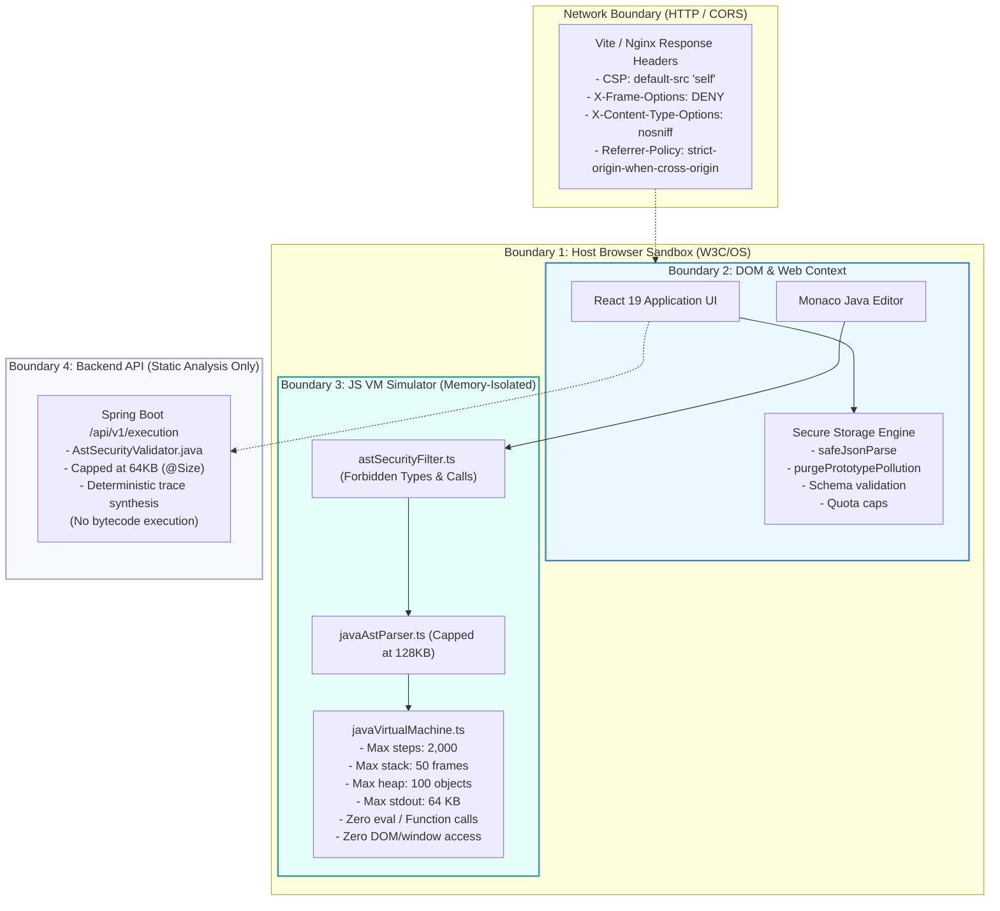

# OOPS LAB — Local-First Security Architecture & Boundary Model

**Document ID:** SEC-LOCAL-FIRST-001  
**Target:** Local-First State, Browser Sandbox, Virtual Machine Simulator, Storage Quotas  
**Standard:** OWASP Local Storage Guidelines, W3C Web Application Security  
**Audit Date:** 2026-11-06  
**Auditor:** Principal Security Architect & Forensic Security Validator  
**Status:** **ACTIVE ARCHITECTURAL SPECIFICATION**

---

## 1. Executive Summary

OOPS LAB operates primarily as an interactive, local-first pedagogical laboratory. The platform enables students to explore Java Object-Oriented Programming (OOP) concepts, class architectures, and execution flows directly in the browser without requiring external server compilation or database accounts.

Because the execution and storage models differ fundamentally from conventional multi-tenant web applications, this document formalizes the **actual security boundaries** that exist in the system, distinguishing client-side guarantees from server-side infrastructure targets.

---

## 2. The Four Actual Trust Boundaries

---

## 3. Boundary Verification Matrix

### Boundary 1: Browser Storage Security
- **Implemented Controls:**
  1. `purgePrototypePollution()`: Recursively strips `__proto__`, `constructor`, and `prototype` keys during JSON parsing.
  2. `safeJsonParse()`: Enforces a strict 512 KB payload size cap on import and catches malformed JSON with zero unhandled exceptions.
  3. `validateLearnerSession()`: Strictly validates types (e.g. non-negative finite numbers, max 100 snippets, max 300 topics, max 64 KB per code snippet).
  4. `clearAllApplicationStorage()`: Securely wipes all `oops*` keys from localStorage on request.
- **What is NOT a Security Boundary:**
  - `localStorage` is **not** an access control boundary against the local user. A student opening browser DevTools can view or modify their own local progress. No passwords, private API keys, or grading credentials are stored in `localStorage`.

### Boundary 2: Java VM Simulator Security
- **Implemented Controls:**
  1. **Zero Dynamic Evaluation:** The simulator (`javaVirtualMachine.ts`) uses an entirely custom AST interpreter. It **never** invokes JavaScript `eval()`, `new Function()`, or dynamic script tags.
  2. **Global Isolation:** Evaluated Java variables are resolved strictly against local stack frames and simulated heap object fields. Java code cannot reference `window`, `document`, `fetch`, `localStorage`, or `IndexedDB`.
  3. **Instruction Budget:** Loop execution is limited to 1,000 loop iterations and an overall execution ceiling of 2,000 steps (`MAX_SIMULATION_STEPS`). Infinite loops emit a `SAFETY TERMINATION` event rather than freezing the UI thread.
  4. **Call Stack Limit:** Call stack depth is capped at 50 frames (`MAX_CALL_STACK_DEPTH`). Infinite recursion throws a simulated `java.lang.StackOverflowError` without causing a JavaScript host engine crash.
  5. **Heap Allocation Limit:** Active allocated instances in the simulated Eden space are capped at 100 objects (`MAX_HEAP_ALLOCATIONS`). Exceeding this quota throws a simulated `java.lang.OutOfMemoryError`.
  6. **Stdout Output Clamp:** Console output buffer is capped at 64 KB (`MAX_STDOUT_BYTES`).
- **Isolation Guarantee:**
  - Each simulation run constructs fresh, isolated data structures (`heapObjects = new Map()`, `stackFrames = []`, `threadTable = new Map()`). Execution state from one program cannot leak into subsequent executions.

### Boundary 3: Static AST Security
- **Implemented Controls:**
  1. **Consistent Filters:** Both Spring Boot `AstSecurityValidator.java` and client `astSecurityFilter.ts` reject dangerous reflection packages (`java.lang.reflect`, `java.lang.invoke`, `java.security`), thread abort methods (`stop`, `suspend`, `resume`), process spawning (`ProcessBuilder`, `Runtime.exec`), and filesystem access (`java.io.File`, `java.nio.file`).
  2. **Fully-Qualified Type Detection:** Rejects unauthorized types whether imported or invoked via inline qualified names (`java.lang.reflect.Method m;`, `new java.io.File(...)`).
  3. **Parser Input Bounds:** The AST parser caps input source length to 128 KB to prevent regex ReDoS or memory bloat.

### Boundary 4: Network & HTTP Response Headers
- **Implemented Controls:**
  - `Content-Security-Policy`: Restricts resource loading to `'self'`, fonts to Google Fonts, workers to `blob:`, and prohibits `object-src`.
  - `X-Frame-Options: DENY`: Prevents iframe clickjacking.
  - `X-Content-Type-Options: nosniff`: Prevents MIME-confusion attacks.
  - `Referrer-Policy: strict-origin-when-cross-origin`: Restricts sensitive URL parameters from leaking.
  - `Permissions-Policy`: Disables camera, microphone, and geolocation.

---

## 4. Current Architecture vs. Future Infrastructure Needs

| Capability | Current Local-First Implementation | Required Future Infrastructure (If Centralized) |
| :--- | :--- | :--- |
| **User Authentication** | Client-side Zustand session simulation (`authStore.ts`) | Spring Security 6, PostgreSQL, Bcrypt password hashing, Redis token blacklist |
| **Multi-Tenant Isolation** | Physical isolation per browser profile / device | Row-Level Security (RLS), tenant-scoped database schemas, server-side JWT ownership validation |
| **Java Bytecode Execution** | In-browser TypeScript VM simulator (`javaVirtualMachine.ts`) | Isolated Linux Kubernetes cluster, gVisor / Kata Containers, seccomp-bpf, JDI execution daemon |
| **Persistent Storage** | Client `localStorage` / `IndexedDB` with schema validation | AWS S3 / Cloud Storage with server-side AES-256 encryption and IAM presigned URLs |
| **Automated Grading** | Client-side AST assertion matching | Sandboxed JUnit execution workers with cryptographic hash verification |

---

## 5. Architectural Verdict

The current architecture provides a **safe, self-contained educational sandbox**. Because student code runs inside an in-browser JavaScript virtual machine without OS access or network capabilities, the platform inherently eliminates remote code execution, server privilege escalation, and lateral movement risks.

