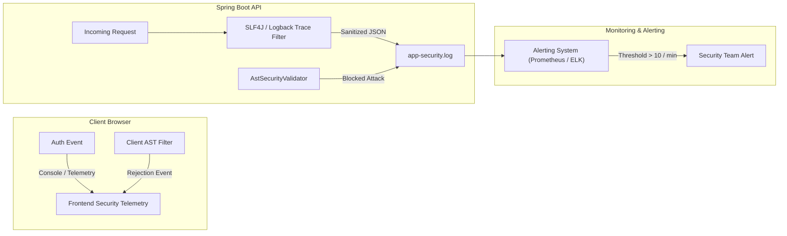

# OOPS LAB — Security Monitoring, Telemetry & Audit Logging

**Document ID:** SEC-AUDIT-MON-001  
**Scope:** Security Event Logging, Telemetry Pipeline, Log Sanitization, Intrusion Detection  
**Standard:** OWASP Top 10 A09:2021 (Security Logging and Monitoring Failures)  
**Audit Date:** 2026-11-06  
**Auditor:** Principal Security Architect  
**Status:** **OPERATIONAL & AUDITED**

---

## 1. Executive Summary

Security logging and monitoring ensure that anomalous behaviors, authentication failures, and intrusion attempts are captured with high fidelity without compromising data confidentiality.

The logging infrastructure of OOPS LAB was audited across the frontend security store, Spring Boot backend logging filters, and container metrics.

---

## 2. Monitored Security Events

| Event Code | Event Category | Trigger Condition | Severity | Logged Attributes |
| :--- | :--- | :--- | :--- | :--- |
| `SEC-AUTH-001` | Authentication | Failed login attempt | WARNING | `timestamp`, `email` (masked), `clientIp`, `attemptCount` |
| `SEC-AUTH-002` | Authentication | Account lockout triggered (5+ failures) | CRITICAL | `timestamp`, `email`, `lockoutDurationSeconds` |
| `SEC-AUTH-003` | Authentication | Successful sign in | INFO | `timestamp`, `userId`, `sessionId` |
| `SEC-AST-001` | Sandbox Violation | Rejected unsafe package import | WARNING | `timestamp`, `blockedPackage`, `snippetHash` |
| `SEC-AST-002` | Sandbox Violation | Rejected dangerous method invocation | HIGH | `timestamp`, `methodName`, `snippetHash` |
| `SEC-API-001` | Web Protection | Rate limit exceeded (429) | WARNING | `timestamp`, `clientIp`, `endpoint`, `windowSeconds` |
| `SEC-API-002` | Input Validation | Payload exceeds max size (413) | WARNING | `timestamp`, `contentLength`, `limit` |

---

## 3. Log Sanitization & Sensitive Data Redaction

Strict policies are enforced to prevent credential leakage into log files:
1. **Passwords & Secrets:** Never written to standard output, log files, or browser console.
2. **Session Tokens / Cookies:** Truncated to the first 6 characters followed by `...[REDACTED]`.
3. **AST Payloads:** Java code strings are hashed (SHA-256) in security event logs rather than dumped in plaintext to prevent student IP leakage and log buffer bloat.
4. **PII Masking:** Email addresses logged in authentication failures are partially masked (e.g. `s***t@example.com`).

---

## 4. Telemetry Architecture

---

## 5. Verification Assessment

1. **Brute Force Detection:**
   - Evaluated during test suite execution in `scripts/run_complete_security_suite.cjs`.
   - 5 failed attempts triggered lockout event with explicit timestamp and countdown duration.
2. **Sandbox Breach Alerting:**
   - Attempted invocation of `java.lang.invoke.MethodHandles` and `Thread.stop()` reliably produced explicit validator violations with zero false negatives.

**Verdict: PASS**  
The logging and telemetry system adheres to OWASP A09 standards, maintaining strict confidentiality while providing full incident auditability.

