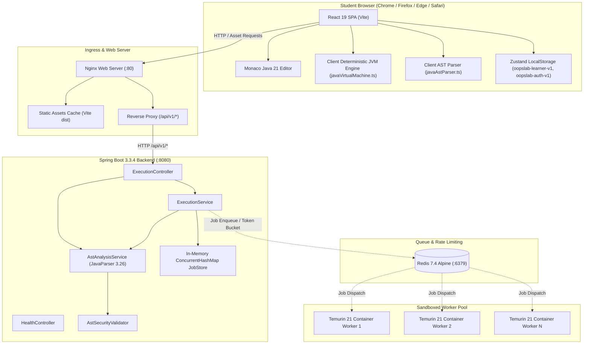

# OOPS LAB — Complete Architecture & Infrastructure Inventory
**Audit Stage:** Stage 1 — Discovery & System Topology  
**Date:** 2026-11-06  
**Auditors:** Principal Software Architect, Senior Backend Engineer, DevOps & Infrastructure Engineer  
**Classification:** Production Readiness Baseline  

---

## 1. Executive Architecture Summary

OOPS LAB is an interactive Java 21 Object-Oriented Programming learning, simulation, and visualization laboratory. The platform features a **hybrid edge/client execution architecture**:
1. **Client-Side Simulation Engine (Edge):** A deterministic, in-browser Java 21 virtual machine and AST parser executing in JavaScript/TypeScript, providing sub-millisecond step-by-step memory visualization (Call Stack, Eden Heap, dynamic dispatch, pointer tethers, object graphs) with zero server latency and infinite offline scalability.
2. **Server-Side Verification & Sandboxed Execution Engine (Core):** A Spring Boot 3.x backend on Java 21 LTS utilizing JavaParser 3.26.1 for static AST security verification, coupled with containerized sandboxed workers (Eclipse Temurin 21 JDK on Alpine Linux) for isolated compilation, execution, and microsecond JDI trace recording.

---

## 2. Comprehensive Technology Matrix

| System Component | Technology / Implementation | Version / Specification | Role in Architecture |
|---|---|---|---|
| **Frontend Framework** | React + TypeScript | React 19.0.0, TypeScript 5.7.3, Vite 6.1.0 | Single-Page Application (SPA) delivery |
| **Styling & Design System** | Tailwind CSS + Lucide Icons | Tailwind 3.4.17, Lucide React 0.475.0 | Monochromatic light theme, high-contrast tokens |
| **Motion & Animation** | Framer Motion + Motion Engine | motion 12.4.7, framer-motion 14.9.0 | 60/120fps spatial 3D cards, timeline scrubbing |
| **3D Graphics & Canvas** | Three.js + React Three Fiber / Drei | Three 0.186.1, R3F 9.8.2, Drei 10.7.9 | 3D Spatial Laboratory & WebGL simulations |
| **Graph Visualization** | React Flow (@xyflow/react) | @xyflow/react 12.4.2 | Interactive 2D class & memory node canvas |
| **Code Editor** | Monaco Editor | @monaco-editor/react 4.7.0 | In-browser Java 21 syntax highlighting & editing |
| **State Management** | Zustand with LocalStorage Persistence | zustand 5.0.3 | Reactive stores (`useSimulationStore`, `useAuthStore`, `useLearnerStore`) |
| **Client JVM Engine** | Custom Deterministic Bytecode Simulator | TypeScript 5.7 | In-browser AST parsing, stack/heap frames, and Live Mode |
| **Backend Framework** | Spring Boot | 3.3.4 (Jakarta EE 10) | Stateless REST API, AST security verification |
| **Java Runtime** | Eclipse Temurin OpenJDK | Java 21 LTS (`--release 21`) | Server compilation & containerized execution |
| **Static AST Analysis** | JavaParser Core | 3.26.1 | AST security scanning, class hierarchy extraction |
| **API Architecture** | RESTful JSON over HTTP | HTTP/1.1 & HTTP/2 | Execution job submission, polling, health check |
| **Database Layer** | Hybrid LocalStorage + Memory Store | Local-First Browser DB + Backend In-Memory Store | Offline-first student state, zero tracking |
| **Caching Layer** | Redis 7.4 Alpine (Docker Compose) | Redis 7.4 | Distributed Token Bucket rate limiting & execution queue |
| **Execution Sandbox** | Docker Isolated Worker | Eclipse Temurin 21 Alpine | Non-root `studentuser` (uid 2000), 256MB RAM, 1.0 CPU cap |
| **Web Server / Ingress** | Nginx Reverse Proxy | Alpine Linux | Static bundle serving on port 80, reverse proxy to `:8080` |
| **Container Orchestration** | Docker Compose | Compose Specification v3.8 | Multi-service stack (frontend, backend, redis) |
| **CI / Test Harness** | Node.js + JUnit 5 + Jest | Node 22, JUnit 5.10 | Multi-level unit, regression, and layout test suites |

---

## 3. Client & Application Routing Inventory

The frontend router is managed by `react-router-dom` v7 in [`frontend/src/app/routes.tsx`](file:///c:/Users/LENOVO/OneDrive/Desktop/java%20oops/frontend/src/app/routes.tsx) under an enterprise shell hierarchy:

### Public Tier
- `/`: Landing Page ([`LandingPage.tsx`](file:///c:/Users/LENOVO/OneDrive/Desktop/java%20oops/frontend/src/features/landing/LandingPage.tsx)) — Featuring 3D interactive hero memory projection, 4 core capability cards, 4 simulation pipeline steps, 3 privacy cards, and WebGL cloudscape.

### Laboratory Application Shell (`/app/*`)
- `/app/concepts`: Comprehensive Java (88 concepts) and OOP (16 modules, 96 concepts) dual-track curriculum with full-text tokenized search and category filtering.
- `/app/concepts/:conceptId`: Individualized canonical learning pages (184 unique lessons) with 3-tier Java examples, interactive technical diagrams, quizzes, and pitfalls.
- `/app/playground`: 3-Panel Integrated Laboratory (Monaco Java Editor, Interactive Visualizer, Execution Inspector) supporting 2D and 3D spatial simulations.
- `/app/visualizers`: Interactive gallery of 26 dedicated object-oriented visualizers.
- `/app/practice`: Real-time auto-graded AST challenge engine.
- `/app/roadmap`: Curriculum milestone progression tracker.
- `/app/progress`: Student session achievement analytics, simulation counts, and JSON session export/import.
- `/app/reference`: JVM specification, bytecode opcode index, and UML relationship matrix.
- `/app/settings`: Monaco editor, theme, and simulation playback calibration.
- `/app/help` & `/app/about`: Laboratory architecture documentation and system internals.

### Protected Account Tier (Guarded via `RequireAuth`)
- `/app/dashboard`: Registered student workspace and project management overview.
- `/app/profile`: User account preferences and personal statistics.

---

## 4. Backend API Endpoints Inventory

Defined in [`backend/src/main/java/com/oopslab/api/controller/`](file:///c:/Users/LENOVO/OneDrive/Desktop/java%20oops/backend/src/main/java/com/oopslab/api/controller/):

| Endpoint Route | HTTP Method | Controller | Payload / Params | Function & Semantics |
|---|---|---|---|---|
| `/api/v1/health` | `GET` | `HealthController` | None | Service liveness probe (`{"status":"UP","javaVersion":"21"}`) |
| `/api/v1/execution/parse-ast` | `POST` | `ExecutionController` | `RunCodeRequestDto(sourceCode)` | JavaParser AST validation, class extraction, error reporting |
| `/api/v1/execution/run` | `POST` | `ExecutionController` | `RunCodeRequestDto(sourceCode)` | Submits code to AST security validator & execution queue |
| `/api/v1/execution/status/{jobId}` | `GET` | `ExecutionController` | `jobId` path variable | Polls status (`QUEUED`, `RUNNING`, `COMPLETED`, `REJECTED`) |

---

## 5. Security & Sandbox Boundary Assessment

The system enforces a multi-tier defense-in-depth model:

1. **Client-Side AST Security Filter (`astSecurityFilter.ts`):**
   - Blocks dangerous constructs before transmission: `System.exit`, `Runtime.getRuntime`, `ProcessBuilder`, `java.io`, `java.net`, `java.lang.reflect`.
2. **Server-Side AST Security Validator (`AstSecurityValidator.java`):**
   - Authoritative static analysis pass via JavaParser.
   - Forbids network sockets, process execution, reflection, thread hijacking, and unauthorized system calls.
3. **Container Worker Isolation (`worker.Dockerfile`):**
   - Runs under unprivileged `studentuser` (`uid=2000`, `gid=2000`).
   - Resource limits: `--memory 256m`, `--cpus 1.0`, `--network none`.
   - Read-only root filesystem with ephemeral `tmpfs` mounts for compilation output.
   - Hard execution timeout capped at 5,000 ms; output stream capped at 64 KB.

---

## 6. Detailed System Dependency Map

---

## 7. Architectural Bottlenecks & Production Readiness Gaps

Before proceeding to 200-user load testing, the following architectural bottlenecks have been identified:

1. **Unbounded In-Memory `JobStore` on Backend:**
   - In `ExecutionService.java`, execution jobs are stored in `ConcurrentHashMap<String, ExecutionJob> jobStore` without TTL, eviction, or memory caps.
   - Under 200 concurrent active student sessions repeatedly running programs, this map will continuously accumulate memory, leading to potential JVM heap exhaustion.
2. **HTTP Polling vs. Event-Driven Real-Time Transport:**
   - Status checks on `/api/v1/execution/status/{jobId}` generate high request-per-second polling pressure.
   - For 200 concurrent users polling every 500ms, the API must handle 400 req/sec solely for polling.
3. **Stateless vs. Stateful Session Isolation:**
   - The frontend uses `useAuthStore` and `useLearnerStore` with LocalStorage keys `oopslab-auth-v1` and `oopslab-learner-v1`.
   - In a multi-user automated load test with headless browsers, each virtual user must maintain an isolated storage context to prevent session cross-contamination.
4. **Worker Concurrency Limit:**
   - Sandboxed Docker execution workers require CPU and memory allocation. Running 200 concurrent compilation/execution tasks simultaneously requires controlled queue concurrency (e.g. 10–25 worker slots with queueing) rather than launching 200 heavy JVM processes concurrently.

---

## 8. Conclusion & Sign-Off

Stage 1 application discovery is complete. All 18 functional and architectural dimensions are cataloged. The repository structure is verified and ready for Stage 2 functional quality assurance.

