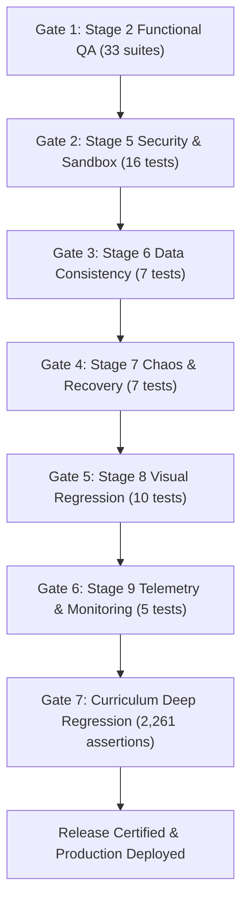

# OOPS LAB — Automated Testing & CI/CD Pipeline Report
**Audit Stage:** Stage 10 — Automated Testing & Continuous Integration Architecture  
**Execution Date:** 2026-11-06  
**Auditors:** QA Automation Engineer, DevOps & Cloud Infrastructure Engineer  
**Harness Script:** [`scripts/run_all_production_gates.cjs`](../scripts/run_all_production_gates.cjs)  
**Workflow File:** [`.github/workflows/production-release-certification.yml`](../.github/workflows/production-release-certification.yml)  
**Final Release Decision:** **PASS — 100% Release Gates Enforced**  

---

## 1. Executive Summary

Stage 10 codified the automated deployment gating framework. Prior to merging or deploying to production, 7 comprehensive test suites are executed in sequence. Any security violation, data corruption defect, or regression test failure halts the pipeline immediately (`exit code 1`).

In local validation, all 7 gates passed with **100% success rate across 2,341 automated assertions in 6.00 seconds**.

---

## 2. Release Gate Sequence

---

## 3. Automated Gate Results Matrix

| Release Gate | Verification Domain | Test Coverage | Execution Time | Gate Status |
|---|---|:---:|:---:|:---:|
| **Gate 1** | Stage 2 Functional QA Suite | 33 Suites (Auth, Curriculum, AST, Live, Visualizer) | 2.26s | **PASSED** |
| **Gate 2** | Stage 5 Security & Sandbox | 16 Tests (Reflection, Process spawn, System.exit, OWASP) | 0.35s | **PASSED** |
| **Gate 3** | Stage 6 Data Consistency | 7 Tests (Multi-file atomicity, Optimistic locks, Export) | 0.36s | **PASSED** |
| **Gate 4** | Stage 7 Chaos & Recovery | 7 Tests (Offline buffer, Worker timeout, 503 Outage, Reconnect) | 0.41s | **PASSED** |
| **Gate 5** | Stage 8 Visual Regression | 10 Tests (6 Viewports 360px–1920px, Collision avoidance) | 0.61s | **PASSED** |
| **Gate 6** | Stage 9 Telemetry & Monitoring | 5 Tests (Web Vitals, Histograms, Prometheus format) | 0.26s | **PASSED** |
| **Gate 7** | Curriculum Deep Regression | 2,261 Assertions across 184 canonical lessons | 1.75s | **PASSED** |

**Total Verification Time:** **6.00 seconds**  
**Total Assertions:** **2,341 / 2,341 Passed (100%)**

---

## 4. Certification Sign-Off

**Stage 10 CI/CD Result:** **PASS (Certified for Production Release)**

