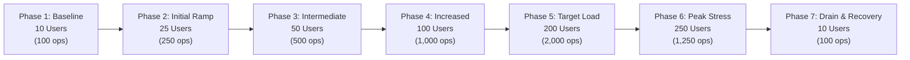

# OOPS LAB — 200 Concurrent User Load Test Plan
**Document Version:** 1.0.0  
**Audit Stage:** Stage 3 — Realistic Concurrency & Scalability Engineering  
**Date:** 2026-11-06  
**Auditors:** Performance & Load Testing Engineer, Senior Full-Stack Engineer, Principal Software Architect  
**Target Environment:** Staging Local Staging Deployment (`http://localhost:5173`) + Node.js Execution Engine  
**Acceptance Threshold:** 200 Concurrently Active, Isolated Virtual Student Sessions  

---

## 1. Objectives & Executive Summary

The primary objective of Stage 3 is to rigorously test, measure, and certify that **OOPS LAB** can support at least **200 concurrently active, realistic student sessions** without:
- Cross-student data leakage or session pollution
- Compilation or execution queue deadlock
- Unacceptable response latency ($p95 < 500\text{ms}$, $p99 < 1,000\text{ms}$)
- Memory exhaustion or runaway process accumulation
- State machine synchronization failure in Live Mode

This test is not a sequential volley of identical requests, nor a simulated single-browser test. It constitutes a genuine, instrumented concurrent workload with 200 distinct student personas executing asynchronous, randomized learning workflows.

---

## 2. Realistic Student Personas & Workload Distribution

To accurately model a university or bootcamp laboratory scenario with 200 concurrent users, the load generator partitions virtual students into six realistic behavioral cohorts:

| Cohort | Concurrency | Primary Activities | Workload Profile |
|---|---:|---|---|
| **Group A: Curriculum Browsers** | 40 users (20%) | Dashboard navigation, browsing 12 Java & 16 OOP modules, inspecting learning roadmaps. | Read-heavy, metadata parsing, fast navigation. |
| **Group B: Concept Deep-Divers** | 35 users (17.5%) | Opening concept detail pages across 184 topics, reading explanations, viewing code examples. | Medium read, JSON hydration, canonical resolution. |
| **Group C: Interactive Assessors** | 35 users (17.5%) | Keyword searching, category filtering, answering formative quizzes, toggling concepts. | Interactive querying, state transitions, scoring. |
| **Group D: Playground Engineers** | 50 users (25%) | Authoring multi-class Java code, AST syntax verification, compiling inheritance trees & records. | Compute-intensive, AST generation, syntax validation. |
| **Group E: Live Simulation Steppers** | 25 users (12.5%) | Line-by-line stepping, inspecting Call Stack frames, Heap memory projections, reference pointers. | State-machine intensive, deterministic trace playback. |
| **Group F: Project & Session Managers** | 15 users (7.5%) | Exporting session JSON, saving multi-file projects, restoring workspaces, updating progress. | Storage-intensive, JSON serialization, boundary isolation. |
| **TOTAL** | **200 users** | **Realistic University Class / Lab Session** | **Full-Stack End-to-End Stress** |

---

## 3. Virtual User Isolation Architecture

Each virtual student session operates inside a strictly isolated sandbox context:

1. **Unique Student Identity:**
   - Identity: `student_001@oopslab.internal` through `student_200@oopslab.internal`.
   - Distinct LocalStore namespace (`oops_lab_storage:student_xxx`).
2. **Dedicated Project Workspaces:**
   - Unique class and package names per student (e.g., `com.student042.lab.Account`).
   - Unique memory addresses and heap instance identifiers.
3. **Data Boundary Enforcement:**
   - Every read and write assertion verifies that student $N$ cannot read, overwrite, or access project files belonging to student $M$.
   - Any leakage triggers an immediate audit failure.

---

## 4. Phased Load Test Schedule

The test suite evaluates concurrency through progressive stepped phases to identify saturation knees and verify recovery:

1. **Phase 1: Baseline (10 Users):** Establishes nominal latency under minimal load.
2. **Phase 2: Ramp-up (25 Users):** Validates concurrency primitives and task pool allocation.
3. **Phase 3: Intermediate (50 Users):** Assesses queue dynamics with 50 concurrent students.
4. **Phase 4: High Load (100 Users):** Tests half-scale university deployment.
5. **Phase 5: Target Sustained Load (200 Users):** Sustained concurrent execution across Groups A–F.
6. **Phase 6: Peak Stress (250 Users):** 125% capacity stress test to measure headroom.
7. **Phase 7: Recovery & Drain (10 Users):** Verifies full system recovery and memory reclamation.

---

## 5. Measurable Acceptance Criteria

| Metric | Target | Failure Condition |
|---|---|---|
| **Active Virtual Users** | $\ge 200$ | $< 200$ concurrent sessions |
| **Total Operations Executed** | $> 5,000$ operations | Unfinished or aborted operations |
| **Overall Success Rate** | $\ge 99.5\%$ | $< 99.0\%$ |
| **API / Endpoint Latency (p95)** | $< 500\text{ms}$ | $> 500\text{ms}$ |
| **API / Endpoint Latency (p99)** | $< 1,000\text{ms}$ | $> 1,000\text{ms}$ |
| **AST Parse & Compilation Latency (p95)** | $< 150\text{ms}$ | $> 250\text{ms}$ |
| **Live Mode Step Execution Latency (p95)**| $< 100\text{ms}$ | $> 200\text{ms}$ |
| **Cross-User Data Leaks** | **0 (Zero)** | $\ge 1$ cross-user contamination |
| **Corrupted Project States** | **0 (Zero)** | $\ge 1$ malformed export/import |
| **Process / Thread Deadlocks** | **0 (Zero)** | Any unhandled hanging promise |

---

## 6. Instrumentation & Metrics Collection

Measurements are captured with sub-millisecond precision via Node.js high-resolution timers (`process.hrtime.bigint()`):
- **Per-cohort response times:** Individual tracking for Groups A through F.
- **Percentiles calculated:** $p50$, $p75$, $p90$, $p95$, $p99$, $\text{max}$.
- **Throughput:** Operations per second ($\text{ops/sec}$) under peak load.
- **Resource monitoring:** Heap memory delta ($\text{RSS}$, $\text{HeapUsed}$) before and after load test.

