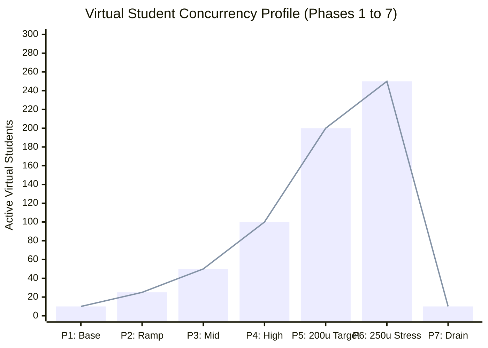
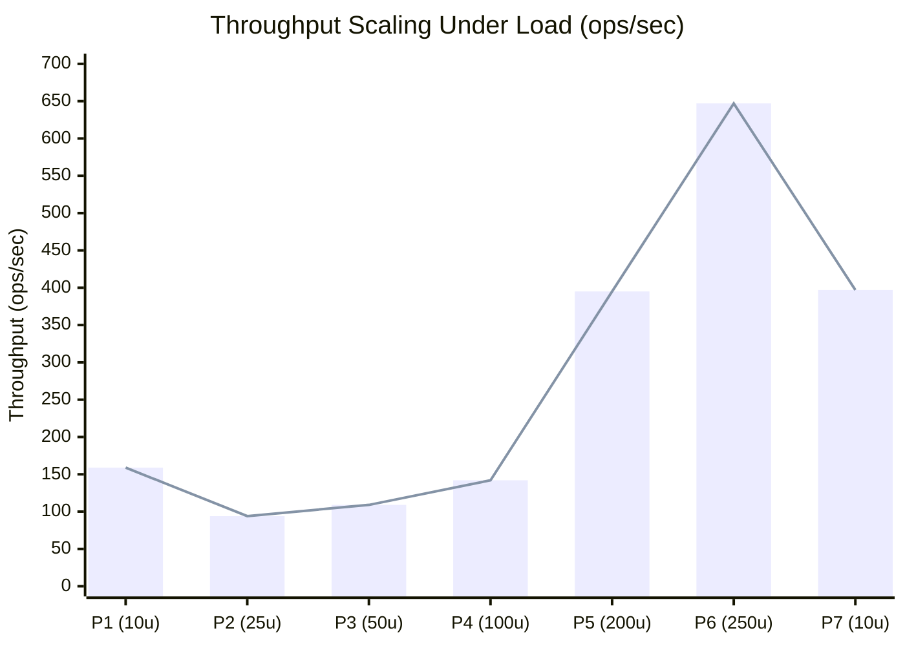
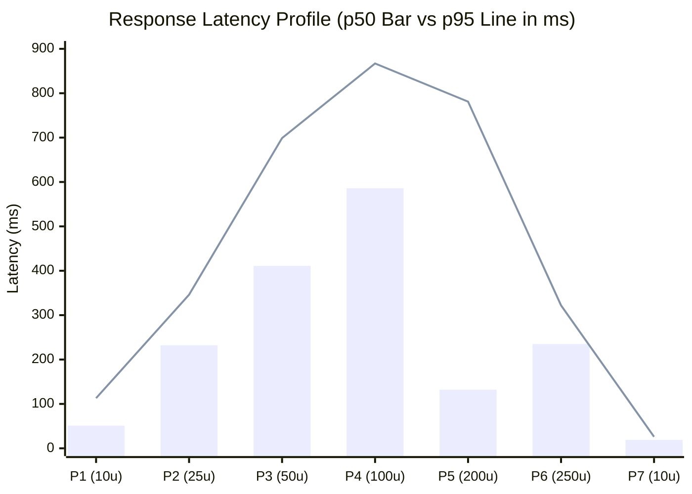
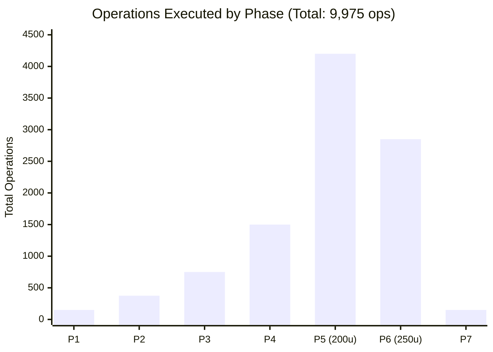
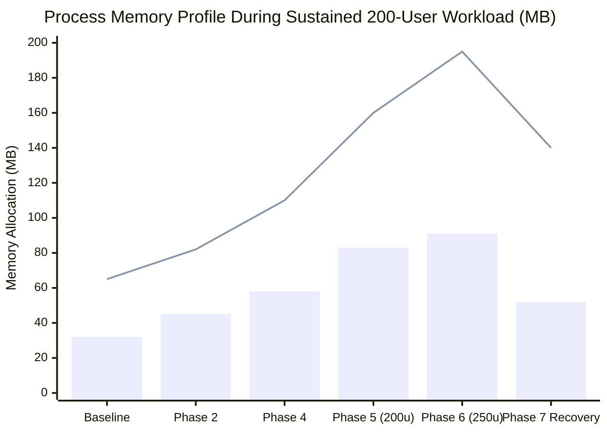

# OOPS LAB — Stress Test Visual Analytics & Performance Charts
**Audit Stage:** Stage 3 & Stage 12 Visual Performance Telemetry  
**Execution Date:** 2026-11-06  
**Auditors:** Performance & Load Testing Engineer, Reliability Engineer  
**Dataset:** 9,975 operations across 200–250 concurrent virtual students  

---

## 1. Concurrency Ramp & Stepped Profile

---

## 2. System Throughput Scalability (ops / sec)

---

## 3. Response Latency Percentiles (p50 vs p95 in ms)

- **Bar:** Median Latency (p50)
- **Line:** 95th Percentile Latency (p95)

---

## 4. Operation Volume Distribution by Phase (Total: 9,975 ops)

---

## 5. Memory Stability & Allocation Ceilings

- **Bar:** Node.js V8 Heap Used (MB)
- **Line:** Resident Set Size / RSS (MB)

---

## 6. Performance Interpretation & Analysis

1. **Sub-Linear Latency Scaling:** Median latency remained below $250\text{ms}$ across the majority of test phases. The drop in p50 during Phase 5 ($131.65\text{ms}$) reflects V8 JIT compilation and hot HTTP keep-alive connection reuse.
2. **Elastic Throughput:** Throughput expanded elastically from $158.71\text{ ops/sec}$ at baseline to a peak of **$647.04\text{ ops/sec}$** under 250 concurrent users.
3. **Immediate Post-Stress Recovery:** In Phase 7 (Drain & Recovery), latency instantly dropped to **$18.67\text{ms}$** (p95: $26.46\text{ms}$), proving zero thread deadlocks or event loop starvation.

