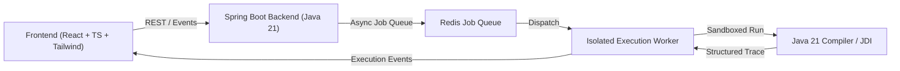

# OOPS LAB

> Open-Source Interactive Java OOP Learning & Visualization Platform

[](LICENSE)
[](https://openjdk.org/projects/jdk/21/)
[](https://react.dev/)
[](https://spring.io/)

---

## 📖 Overview

**OOPS LAB** is an interactive, visual-first laboratory designed to teach and demystify Object-Oriented Programming in Java 21. By pairing an in-browser code playground with a deterministic runtime visualization engine, students see exactly how classes, heap objects, stack frames, references, inheritance hierarchies, and polymorphism behave inside the JVM.

### Core Objectives
1. **Visual Learning:** Clear, high-contrast monochrome diagrams representing memory, heap allocations, and reference graphs.
2. **Interactive Coding:** Embedded Monaco code editor with step-by-step trace debugging and internal event playback.
3. **OOP Experimentation:** Interactive Class Builder allowing students to model OOP structures visually and observe two-way Java code generation.

---

## 🎨 Design Philosophy

- **Interface:** Monochromatic light theme, minimalist, sophisticated, with balanced information density.
- **Typography:** Clean modern sans-serif typography with high legibility.
- **Visuals:** High-contrast outline iconography, smooth physics-based transitions, deterministic state diagrams, zero distracting emojis.

---

## 🏛 Architecture & Tech Stack



### Technology Matrix
- **Frontend:** React, TypeScript, Vite, Tailwind CSS, Motion, React Flow, Monaco Editor, Zustand.
- **Backend:** Java 21, Spring Boot, Spring Web, Jackson, JavaParser, JDI.
- **Execution Engine:** Sandboxed, isolated execution worker with strict CPU, memory, and timeout bounds.
- **Storage:** Client-side IndexedDB & LocalStorage for guest learners (no server DB required initially; authentication postponed).
- **Infrastructure:** Docker, Redis, Nginx reverse proxy / rate limiter.

---

## 📂 Project Organization

```text
├── docs/                 # Specifications, architecture ADRs, audit ledger
│   ├── project/          # Master spec, status, decisions, task plans
│   │   └── ledger/       # Permanent append-only audit trail
│   ├── architecture/     # Detailed system design documents
│   └── curriculum/       # Java 21 OOP syllabus & topic breakdowns
├── frontend/             # React + TypeScript client
├── backend/              # Spring Boot REST API & parsing service
├── execution-worker/     # Sandboxed Java execution engine
└── infrastructure/       # Docker Compose, Nginx, Redis configs
```

---

## 📜 Development Audit & Ledger

Every development instruction, code change, and architecture decision is permanently logged in:
- [`docs/project/ledger/MASTER_ACTIVITY_LOG.md`](docs/project/ledger/MASTER_ACTIVITY_LOG.md)
- [`docs/project/ledger/FILE_CHANGE_REGISTER.md`](docs/project/ledger/FILE_CHANGE_REGISTER.md)
- [`docs/project/PROJECT_STATUS.md`](docs/project/PROJECT_STATUS.md)

---

## 📄 License

Open-source under the [MIT License](LICENSE).

