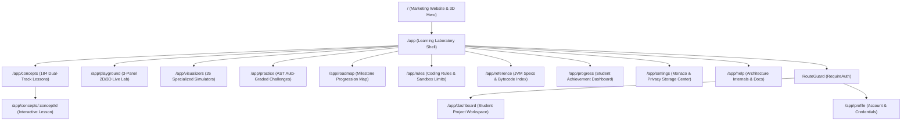

# OOPS LAB — Complete Application & Feature Specification

**Document Title:** OOPS LAB Master Application & Feature Guide  
**Classification:** Definitive Technical & Product Specification  
**Version:** 2.4.0 (Production Release)  
**Authors:** Principal Software Architect, Senior Full-Stack Engineer, Lead Simulation Engineer  
**Date:** 2026-11-16  

---

## 1. Executive Summary & Vision

**OOPS LAB** is an open-source, interactive Java 21 Object-Oriented Programming learning, simulation, and visualization laboratory. It bridges the critical cognitive gap between abstract code declarations and runtime physical realities within the Java Virtual Machine (JVM).

Unlike static documentation, code sandboxes, or generic slideshows, OOPS LAB provides a **deterministic, bidirectional execution visualizer** that renders memory structures—such as Call Stack frames, Eden Heap allocations, reference pointer tethers, polymorphic dispatch lookups, encapsulation boundaries, and dynamic thread states—in both 2D and 3D spatial environments.

### Core Architectural Principles
1. **Zero-Latency In-Browser Simulator (Edge Engine):** Executes Java 21 code client-side using a deterministic AST parser and virtual machine, eliminating server round-trip latency for sub-millisecond step-by-step playback.
2. **Deterministic Dual-Mode Visualization:** Real-time state machine emitting typed execution events to synchronize the code editor, visual canvas, and execution inspector.
3. **Monochromatic Sophisticated Design System:** Minimalist, balanced density, high-contrast typography, outline-only icons, and zero distracting visual clutter.
4. **Offline-First & Local Privacy:** Guest students have full access to all curriculum, visualizer, and simulation tools. User workspace state, notes, and progress persist locally in client storage without tracking.

---

## 2. Technology Stack & Infrastructure

| Layer | Technologies | Role / Specifications |
|---|---|---|
| **Frontend Framework** | React 19, TypeScript 5.7, Vite 6.1 | Modern single-page application delivery |
| **Styling & Design System** | Tailwind CSS 3.4, Lucide Icons | Clean monochromatic tokens, responsive layouts, 8pt spatial grid |
| **Motion Engine** | Motion 12.4, Framer Motion 14.9 | Hardware-accelerated 60/120fps physics, timeline scrubbing |
| **3D Spatial Graphics** | Three.js 0.186, React Three Fiber 9.8, Drei 10.7 | WebGL 3D spatial laboratory and interactive memory projections |
| **2D Graph Architecture** | React Flow (@xyflow/react 12.4) | Interactive node-link diagrams and hierarchy maps |
| **Code Editor** | Monaco Editor (@monaco-editor/react 4.7) | Professional Java 21 syntax highlighting, gutter markers, errors |
| **State Management** | Zustand 5.0 with LocalStorage Persistence | Reactive stores for simulation, curriculum, auth, and workspace |
| **Client JVM Simulator** | Custom Bytecode & AST Interpreter | Java 21 LTS syntax, records, sealed types, pattern matching |
| **Backend Core (Optional)** | Spring Boot 3.3 (Java 21 LTS), JavaParser 3.26 | Static AST security analysis, server-side compilation fallback |
| **Container Sandbox** | Eclipse Temurin 21 OpenJDK on Alpine Linux | Non-root isolated worker, 256MB RAM cap, `--network none` |
| **Automated Test Harness** | Playwright 1.65, Node.js Test Harness, Jest 29 | Functional QA (33 tests), Concept regression (2,261 tests), Security (29 tests) |

---

## 3. Application Route & Navigation Taxonomy

The application operates under a unified router hierarchy managed by `react-router-dom`:



---

## 4. Comprehensive Feature Catalog

### 4.1. Marketing Website & Interactive Spatial Hero (`/`)
- **Interactive 3D Memory Projection Hero:** A WebGL interactive canvas rendering floating JVM memory blocks, reference arrows, and physical metaphors with dynamic specular glare, opposite 3D drop shadows, and 120fps cursor tracking.
- **System Compatibility Scanner:** One-click launcher from the hero button ("Enter JVM Laboratory") triggering an interactive system scan before entry.
- **The 4 Core Capabilities Section:** Interactive cards illustrating:
  1. *Sub-Millisecond Java Execution:* Instant step-by-step AST parsing.
  2. *Live Eden Heap Fabricator:* Invariant object allocation and mutation tracking.
  3. *Obstacle-Free Reference Connectors:* Laser-straight routing around obstacles.
  4. *Polymorphic Dispatch Radar:* Visualizing runtime virtual method tables (vtable).
- **Simulation Pipeline Architecture:** Visual walkthrough of the 4 compilation and runtime stages: AST Parsing $\to$ Bytecode Synthesis $\to$ Memory Allocation $\to$ Dynamic Connector Routing.
- **Privacy & Security Matrix:** Clear declaration of zero student telemetry, zero third-party cookies, and sandboxed isolated execution.

---

### 4.2. System Compatibility Cockpit (`SystemCompatibilityModal.tsx`)
A cockpit-inspired modal displaying real-time hardware and browser suitability metrics:
- **Radar Sonar Sweep & Laser Beam Scan:** Animated 120fps sweep bar scanning the client environment.
- **Compatibility Audit Matrix:**
  1. *WebGL & Hardware Acceleration:* Verifies WebGL 2.0 and GPU shader support for 3D simulation.
  2. *JVM Client Simulator Engine:* Verifies browser JavaScript engine support for modern ES2023 constructs.
  3. *Local-First Storage Subsystem:* Checks IndexedDB and LocalStorage quota availability.
  4. *Viewport & Display Geometry:* Measures client resolution against the recommended 1280x800 desktop standard.
  5. *Multi-Core Processing Concurrency:* Detects `navigator.hardwareConcurrency` for worker thread threading.
- **Rollup Compatibility Score:** Animated score counter (0–100%) certifying suitability.
- **One-Click Workspace Entry:** Immediately navigates into `/app/concepts` with zero forced account registration.

---

### 4.3. Dual-Track Curriculum Catalog (`/app/concepts`)
A curriculum containing **184 individualized canonical lessons** split across two dedicated learning tracks:

#### Track 1: Java Programming Mastery (88 Concepts, 12 Modules)
- **Module 01: Core Syntax & Data Types** (Variables, primitive types, wrapper classes, overflow, constants, operators).
- **Module 02: Control Flow & Logic** (Conditionals, switch expressions, loops, break/continue, label jumping).
- **Module 03: Methods & Scope** (Parameters, return mechanics, pass-by-value, variable shadowing, recursion).
- **Module 04: Arrays & Multi-Dimensional Data** (Array memory allocation, bounds checking, multidimensional arrays, copying).
- **Module 05: Strings & Text Processing** (String pool, immutability, StringBuilder, text blocks, regex).
- **Module 06: Object Lifecycle** (Constructors, `this` reference, garbage collection, finalization, heap allocation).
- **Module 07: Packages & Access Control** (Package namespaces, import rules, private, default, protected, public).
- **Module 08: Exception Handling** (Try-catch-finally, checked vs unchecked, try-with-resources, custom exceptions).
- **Module 09: Java Collections Framework** (List, Set, Map, ArrayList vs LinkedList, Queue, Deque).
- **Module 10: Generics & Type Safety** (Generic classes, methods, wildcards, bounded types, type erasure).
- **Module 11: Lambdas & Streams** (Functional interfaces, stream pipelines, map-filter-reduce, method references).
- **Module 12: Modern Java 21 Features** (Records, sealed classes, pattern matching switch, virtual threads).

#### Track 2: Object-Oriented Principles (96 Concepts, 16 Modules)
- **Module A: Classes & Blueprint Mechanics** (Class declarations, instance members, static members, member visibility).
- **Module B: Encapsulation & Data Hiding** (Getter/setter encapsulation, immutability, data invariants).
- **Module C: Inheritance & Hierarchies** (Subclassing, super constructors, method overriding, shadow fields).
- **Module D: Polymorphism & Dynamic Dispatch** (Runtime method tables, upcasting, downcasting, `instanceof` patterns).
- **Module E: Abstraction & Abstract Classes** (Partial implementation, abstract methods, template method pattern).
- **Module F: Interfaces & Multiple Inheritance** (Interface contracts, default methods, static methods, diamond resolution).
- **Module G: Composition & Aggregation** (Has-A vs Is-A, entity nesting, component lifecycle).
- **Module H: Association & Dependency** (Coupling, method dependencies, reference delegation).
- **Module I: Inner & Nested Classes** (Static nested, inner member, local classes, anonymous inner classes).
- **Module J: Object Class Contract** (`equals()`, `hashCode()`, `toString()`, identity equality vs equivalence).
- **Module K: Enums & Constant Blueprints** (Enum declarations, enum methods, singleton patterns).
- **Module L: Modern Records & Crystals** (Record constructors, accessor generation, deconstruction patterns).
- **Module M: Sealed Hierarchies** (Sealed classes, permitted subclasses, exhaustive switch expressions).
- **Module N: SOLID Architectural Principles** (Single responsibility, open-closed, Liskov substitution, interface segregation, dependency inversion).
- **Module O: Design Patterns in Practice** (Factory, Singleton, Builder, Strategy, Observer, Decorator).
- **Module P: Memory & Architecture Models** (Stack frames, Eden heap, generational memory, reference lifespans).

#### Interactive Features of the Curriculum Page:
- **Dynamic Track Switcher with GPU AeroShards Transition:** Seamless animated transition between Java and OOP curricula with glass shard particle burst.
- **Real-Time Tokenized Search:** Tokenizes queries with partial matching, module weighting, and highlight badges.
- **Collapsible Module Accordions:** Hardware-accelerated `.oops-accordion-grid` with rotating chevrons.

---

### 4.4. Individualized Canonical Lessons (`/app/concepts/:conceptId`)
Every one of the 184 concepts renders an individualized lesson view:
- **Concept Guide Header:** Title, module badge, difficulty indicator (Beginner, Intermediate, Advanced), and concise summary.
- **3-Tier Interactive Java Code Examples:**
  1. *Beginner Tier:* Minimal syntax declaration.
  2. *Intermediate Tier:* Real-world interaction with multiple collaborating classes.
  3. *Advanced / Edge-Case Tier:* Java 21 edge cases, potential pitfalls, and JVM internal mechanics.
- **Embedded Interactive Technical Diagram:** Dynamic 2D graph visualizing the exact memory layout or UML relationship for that lesson.
- **Formative Assessment Quiz:** Multiple-choice quiz with immediate visual feedback, detailed explanations, and retry mechanics.
- **Common Pitfalls & Anti-Patterns:** Highlighted callouts alerting students to compile-time traps and runtime exceptions.
- **One-Click Playground Launcher:** Loads the lesson's code directly into the 3-panel simulation laboratory.
- **Universal Lesson Navigation Footer:** Prev/Next buttons navigating linearly across the entire curriculum chain.

---

### 4.5. The 3-Panel Simulation Laboratory (`/app/playground`)
The primary engineering workspace integrating code authoring, spatial visualization, and technical execution analysis:

```
+----------------------------------------------------------------------------------------------------+
| TOP TOOLBAR: Project Selector | Java 21 LTS | Compile & Run | Timeline Controls | 2D/3D Mode Switcher      |
+------------------------------------+------------------------------------+--------------------------+
| PANEL 1: JAVA 21 CODE EDITOR       | PANEL 2: INTERACTIVE VISUALIZER    | PANEL 3: EXECUTION       |
|                                    |                                    |          INSPECTOR       |
| - Monaco Editor                    | - 2D Simulation Canvas             | - Call Stack Frames      |
| - Multi-File Project File Tree     | - 3D Spatial Laboratory            | - Eden Heap Registry     |
| - Active Line Execution Gutter     | - AABB Collision-Free Layout       | - Object Inspector       |
| - Syntax & AST Error Diagnostics   | - Laser Reference Connectors       | - Terminal & Console     |
+------------------------------------+------------------------------------+--------------------------+
| BOTTOM PANEL: Execution Scrubber Timeline (Step-by-step forward/backward slider, event descriptions)|
+----------------------------------------------------------------------------------------------------+
```

#### Panel 1: Java Code Editor & Multi-File Tree
- **Multi-File Workspace Tree:** Create, edit, rename, and delete Java source files (`Main.java`, `User.java`, etc.).
- **AST Parser Integration:** Background parser extracting classes, fields, methods, constructors, records, and relationships.
- **Execution Gutter Pointer:** Highlights the active line of code executing at the current step.

#### Panel 2: Interactive Visualizer (Dual Dimensions)
- **Visualizer Dimension Toggle:** Instant toggle between **2D Lab** and **3D Spatial** without losing execution progress.
- **Interactive 2D Canvas:**
  - *Multi-Column Horizontal Wrapping Layout:* Objects wrap horizontally into multi-column grid lanes (max ~3 cards per column, `MAX_COLUMN_HEIGHT = 820px`), preventing single endless vertical stacks.
  - *Smooth 2D Panning:* Use mouse wheel or trackpad to pan horizontally and vertically, holding `Ctrl` to zoom.
  - *Directional Pan Controls:* Floating toolbar with `[←]`, `[↑]`, `[↓]`, `[→]` buttons for 1-click panning.
  - *Auto-Fit Engine:* Calculates graph bounding box to center all objects cleanly.
  - *Physical Metaphor Object Cards:*
    - Vault (Encapsulated classes with shield badges).
    - Chassis (Inherited subclasses with layered badges).
    - Crystal (Java 21 Records with gem badges).
    - Factory (Standard blueprints with factory badges).
  - *Obstacle-Free Laser Connectors:* Orthogonal bypass routing around cards with zero interior crossings.
  - *Left Docked Object Registry:* Alphabetical registry of active heap entities; clicking an object immediately centers it in the viewport.
- **Interactive 3D Spatial Laboratory:**
  - *Orbital Camera Controls:* Orbit, pan, and zoom in 3D WebGL space.
  - *Z-Plane Layering:* Stack frames, heap instances, and static blueprints placed on distinct spatial depth layers.
  - *Spatial Pointer Tethers:* 3D glowing tethers linking stack reference variables to heap objects.

#### Panel 3: Execution Inspector & Terminal
- **Active Stack Frames:** Displays method frames with local variable slots, type badges, and current values.
- **Heap Object Registry:** Displays runtime memory addresses (e.g. `OBJ-001`), field states, and reference pointers.
- **Terminal & Execution Console:** Captures standard output (`System.out.println`) and formatted runtime exceptions.
- **Technical Drawer:** Collapsible tabbed drawer for deep JVM memory telemetry and variable state tracking.

#### Execution Timeline Scrubber
- **Bidirectional Stepping State Machine:** Step forward (`Step Into`, `Step Over`, `Step Out`), Step backward, or Jump to any step.
- **Playback Controls:** Auto-play loop with speed multiplier (`0.5x`, `1.0x`, `2.0x`).
- **Contextual Event Descriptions:** Natural language explanation of what changed in the current execution step.

---

### 4.6. Visualizer Gallery (`/app/visualizers`)
A dedicated gallery of **26 specialized visualizer engines** covering individual concepts:
- **Scenario Selector:** Switch between beginner, intermediate, and advanced scenarios for each concept.
- **Auto-Layout & Auto-Fit:** One-click graph rebalancing and viewport centering.
- **Side-by-Side Concept Guide & Java Code:** Drawer allowing students to view the underlying code while interacting with the graph.

---

### 4.7. Auto-Graded Practice Challenges (`/app/practice`)
- **Interactive Coding Challenges:** Targeted programming problems focusing on encapsulation, polymorphism, inheritance, and interfaces.
- **Real-Time AST Grader:** Validates student code structure against required OOP principles (e.g., verifying fields are private, checking inheritance relationships) without requiring server compilation.
- **Instant Test Feedback:** Clear pass/fail indicators with automated hints for failed test cases.

---

### 4.8. Curriculum Roadmap (`/app/roadmap`)
- **Milestone Dependency Graph:** Visual roadmap showing prerequisite concepts and progression tracks.
- **Interactive Accordion Milestones:** Expand milestones to see completed vs pending lessons.
- **Direct Navigation Links:** Click any milestone to jump directly to its lesson.

---

### 4.9. JVM Reference & Opcode Matrix (`/app/reference`)
- **Bytecode Opcode Index:** Quick-reference dictionary of common JVM opcodes (`aload`, `invokevirtual`, `invokespecial`, `new`).
- **Memory Model Reference:** Technical diagrams explaining PermGen/Metaspace, Eden space, Survivor spaces, and Tenured Heap.
- **UML Relationship Cheat Sheet:** Visual guide to UML arrows (Generalization, Realization, Association, Aggregation, Composition, Dependency).

---

### 4.10. Coding Rules & Sandbox Specifications (`/app/rules`)
- **Language Rules:** Details supported Java 21 LTS features (Records, Sealed Types, Switch Expressions, Pattern Matching).
- **Sandbox Restrictions:** Explains blocked operations (`System.exit`, `Runtime.getRuntime`, `ProcessBuilder`, `java.io`, `java.net`).
- **Execution Quotas:** Explains memory caps (256MB), CPU limits (1.0 core), timeout thresholds (5,000ms), and output limits (64KB).
- **Exception Mechanics:** Explains how NullPointerException, ClassCastException, and StackOverflowError are visualized.
- **Interactive Template Launchers:** One-click buttons to launch verified templates directly into the Playground.

---

### 4.11. Progress Hub & Beta Credentials (`/app/progress`)
- **Learning Progress Tracker:** Visual breakdown of completed lessons, simulation hours, and practice scores.
- **Session Export & Import:** Export student session state to JSON for offline backup or migration to another device.
- **Beta Access Gate:** Allows beta testers to register and access preview capabilities.

---

### 4.12. Settings & Privacy Center (`/app/settings`)
- **Monaco Editor Calibration:** Customize font size, tab spacing, minimap display, and word wrap.
- **Theme & Motion Preferences:** Toggle animations, calibrate 3D camera sensitivity, and set default visualizer mode.
- **Local Storage & Privacy Center:**
  - Real-time diagnostic table showing client storage usage by category.
  - Prefix-scoped data purge guaranteeing zero impact on personal browser data.
  - Confirmation modals protecting against accidental data deletion.

---

### 4.13. Security Architecture & Automated Testing
The application implements defense-in-depth security:
- **Client AST Security Scanner (`astSecurityFilter.ts`):** Scans code before execution to block dangerous APIs.
- **Server AST Validator (`AstSecurityValidator.java`):** Authoritative static analysis pass in the Spring Boot backend.
- **Docker Container Worker Sandbox:** Isolated container running under unprivileged user `studentuser` with `--network none`.
- **Playwright Automated Security Suite (29 Tests):**
  - *React Security:* XSS, DOM injection, unsafe HTML rendering, token exposure, insecure storage, open redirect validation, CSP headers, and browser security headers.
  - *Node/Runtime Security:* SQL/NoSQL resilience, command injection, SSRF, path traversal, JWT tampering, session invalidation, CSRF, CORS, brute-force lockout, auth bypass, mass assignment, and error disclosure.
  - *API & Authorization:* BOLA/IDOR, BFLA, excessive data exposure, unauthenticated endpoint matrix, tenant cryptographic isolation, and payload size caps.

---

## 5. Verification & Test Commands

To verify and run the test suites:

```powershell
# 1. Run Stage 2 Functional QA Suite (33 tests covering Auth, Curriculum, Playground, JDI VM, Geometry)
node scripts/run_stage2_functional_qa.cjs

# 2. Run Curriculum Regression Suite (2,261 assertions covering 184 canonical lessons)
node scripts/verify_concepts_regression.cjs

# 3. Run Playwright End-to-End Security Suite (29 tests covering React, Node, and API security)
npx playwright test

# 4. Run Security Audit Master Harness & Generate Report
node scripts/run_security_playwright_suite.cjs

# 5. Build Frontend Production Bundle (TypeScript check + Vite bundle)
pnpm --dir frontend run build
```

---

## 6. Document Metadata & Permanent Audit Trail
- **Audit Record:** [`docs/project/ledger/records/OOPS-20261116-0240-COMPLETE_APPLICATION_SPECIFICATION.md`](file:///c:/Users/LENOVO/OneDrive/Desktop/java%20oops/docs/project/ledger/records/OOPS-20261116-0240-COMPLETE_APPLICATION_SPECIFICATION.md)
- **Master Activity Log:** Logged in [`docs/project/ledger/MASTER_ACTIVITY_LOG.md`](file:///c:/Users/LENOVO/OneDrive/Desktop/java%20oops/docs/project/ledger/MASTER_ACTIVITY_LOG.md) (Task `OOPS-20261116-0240`, Checkpoint `CP-0182`)
- **File Change Register:** Logged in [`docs/project/ledger/FILE_CHANGE_REGISTER.md`](file:///c:/Users/LENOVO/OneDrive/Desktop/java%20oops/docs/project/ledger/FILE_CHANGE_REGISTER.md)
