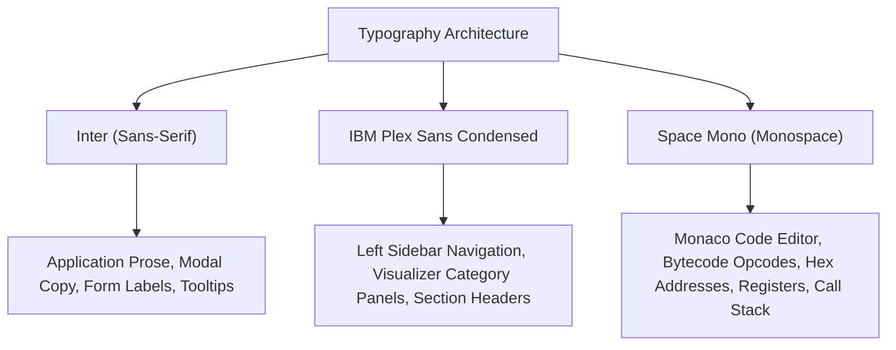
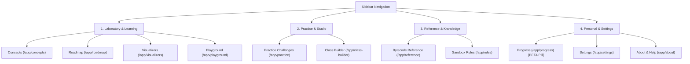
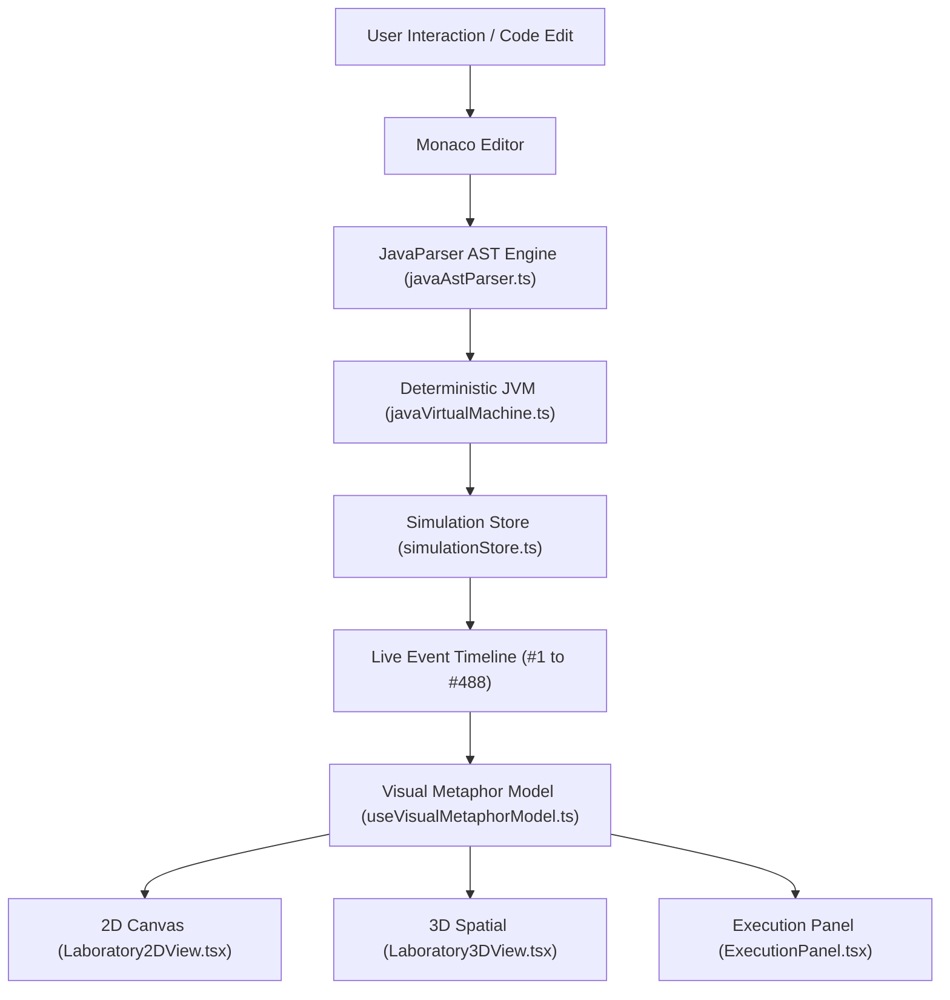

# OOPS LAB — Exhaustive Frontend UI & Component Specification

> **Document Type:** Canonical Master Frontend UI & Interaction Specification  
> **Release Target:** OOPS LAB 2.0.0 Production Architecture  
> **Author:** Antigravity Principal UI Architect & Full-Stack System Lead  
> **Repository:** `oops-lab` | **Directory:** `frontend/src/`  
> **Standards Compliance:** W3C WCAG 2.1 AA, Java 21 LTS Syntax, ISO/IEC 9075, ASVS L2 Client Security  
> **Rule of Completeness:** *Every visible surface, component, design token, font scale, interaction mode, layout boundary, drawer, node type, modal, canvas, and animation that exists in the frontend codebase is explicitly detailed in this document. If it is rendered on screen, it is documented here.*

---

## 1. Global Design System, Tokens & Visual Identity

### 1.1 Visual Identity & Monochromatic Philosophy
OOPS LAB adheres to an uncompromising **monochromatic light aesthetic**, intentionally avoiding playful or cartoonish visual cliches often found in educational tools. The design evokes the tactile precision of an industrial laboratory instrument, high-end IDE, or scientific workstation.

- **Primary Canvas Base:** Pure white (`#FFFFFF`) providing maximum clarity and optical contrast for high-density code reading and complex architectural graphs.
- **Surface Elevation Hierarchy:**
  - Base Background: `--background: #FFFFFF`
  - Elevated Surface Layer: `--surface: #FFFFFF`
  - Subtle Shaded Section / Secondary Canvas: `--surface-subtle: #FAFAFA`
  - Muted Inactive Panel / Disabled Containers: `--surface-muted: #F5F5F5`
  - Active Selection / Pressed Item: `--active-background: #EEEEEE`
  - Card Background: `--card: #FFFFFF`
- **Text & Foreground Spectrum:**
  - Dominant Foreground / High Contrast Headers: `--foreground: #171717` (Deep Charcoal, 14.8:1 contrast ratio against `#FFFFFF`)
  - Primary Body Text: `--text-primary: #171717`
  - Secondary Explanatory Text / Subheaders: `--text-secondary: #666666`
  - Muted Captions / Gutter Line Numbers: `--text-muted: #999999`
  - Subtle Labels / De-emphasized Metadata: `--muted-foreground: #71717A`
- **Border & Hairline Geometry:**
  - Standard Dividing Hairline: `--border: #E8E8E8` (1px solid neutral gray)
  - Emphasized Card Border: `--border-strong: #D8D8D8`
  - High-Contrast Active Border / Focused Control: `--border-focus: #18181B`
  - Simulation Playground Panel Divider: `--playground-border: #E5E7EB`
- **Purposeful State & Semantic Accent Tokens:**
  - **Cobalt Blue (`#1263F1` / Hover `#0D4EC4`):** Represents references, memory pointers, primary compilation actions, active selection rings, and Vault encapsulation metaphors.
  - **Amber / Orange (`#F47B20` / Hover `#D66412`):** Represents dynamic runtime execution, active line pointer execution arrows (`▶`), mutated heap fields, and execution step indicators.
  - **Emerald Green (`#287a4b` / `#16A34A`):** Represents verified heap states, successful compilation, passing AST test cases, and completed mastery badges.
  - **Crimson Red (`#EF4444` / `#DC2626` / `#C43B3B`):** Represents runtime exceptions (`EXCEPTION THROWN`), breakpoint glyphs, compilation error squiggles (`⚠`), and memory fault diversions.
  - **Indigo (`#4F46E5` / `#6366F1`):** Represents Chassis inheritance hierarchies, superclass linkages, and interface contracts.
  - **Amber Crystal (`#D97706` / `#F59E0B`):** Represents Record classes, immutable data carriers, and value objects.

---

### 1.2 Typography Hierarchy & Font Stacks

The interface utilizes a tri-font typography stack tailored to scientific and developer tooling:



| Token / Usage | Font Family | Size | Weight | Tracking / Line Height |
| :--- | :--- | :--- | :--- | :--- |
| **`--text-xs`** | `Space Mono` / `Inter` | 11px (`0.6875rem`) | Regular (400) / Bold (700) | `tracking-tight`, line-height 1.3 |
| **`--text-sm`** | `Inter` / `Space Mono` | 12px (`0.75rem`) | Medium (500) | `tracking-normal`, line-height 1.4 |
| **`--text-base`** | `Inter` | 13px (`0.8125rem`) | Regular (400) / Medium (500) | line-height 1.5 |
| **`--text-md`** | `Inter` | 14px (`0.875rem`) | Regular (400) / SemiBold (600) | line-height 1.5 |
| **`--text-lg`** | `Inter` | 16px (`1.0rem`) | SemiBold (600) | `tracking-tight`, line-height 1.4 |
| **`--text-xl`** | `IBM Plex Sans Condensed` | 18px (`1.125rem`) | Bold (700) | `tracking-tight`, line-height 1.3 |
| **`--text-2xl`** | `IBM Plex Sans Condensed` | 22px (`1.375rem`) | Bold (700) | `tracking-tighter`, line-height 1.2 |

#### Specialized Typography Behaviors:
- **`sidebar-search-input::placeholder`:** Strictly styled in `IBM Plex Sans Condensed`, 15px, color `#94A3B8`.
- **Heap Object Addresses & Offsets:** Formatted strictly in uppercase `Space Mono` (e.g. `OBJ-001`, `0x7FFF94B2`, `iconst_1`).
- **Gutter Indicators:** Monaco custom glyph font rendering unicode right-triangle arrow `▶` in `#F47B20` and warning icon `⚠` in `#DC2626`.

---

### 1.3 Iconography Standards
In alignment with the core design rules, the entire frontend uses **Lucide React outline icons exclusively**:
- Stroke widths are strictly constrained to `stroke-[1.5]` or `stroke-[2]`.
- Bounding boxes are uniform: `w-3 h-3` (12px micro), `w-3.5 h-3.5` (14px compact), `w-4 h-4` (16px standard), `w-5 h-5` (20px navigation/header), and `w-6 h-6` (24px hero/modal status).
- **Absolute Ban on Generic Colorful Emojis:** No unicode emojis (e.g. 🚀, 💻, 🔥) are permitted in production component markup. All visual indicators use monochromatic SVG glyphs.

---

### 1.4 Spacing & Geometry Scale
The interface is structured on an **8pt / 16pt primary grid system**:
- Spacing Variables: `--space-1` (4px), `--space-2` (8px), `--space-3` (12px), `--space-4` (16px), `--space-5` (20px), `--space-6` (24px), `--space-8` (32px).
- **Playground Metrics:**
  - Panel Gap: `--playground-panel-gap: 16px`
  - Viewport Edge Padding: `--playground-page-padding: 16px`
  - Internal Section Gap: `--playground-gap: 16px`
- **Corner Radii Tokens:**
  - Mini Pills / Inner Badges: `--radius-sm: 4px` (`rounded`)
  - Inputs / Dropdown Menus: `--radius-md: 6px` (`rounded-md`)
  - Container Cards / Panels: `--radius-lg: 8px` (`rounded-lg`)
  - Interactive Visualizer Heap Cards: `rounded-2xl` (16px) with hairline border
  - Circular Badges / D-Pad Buttons / Avatars: `rounded-full` (9999px)

---

### 1.5 Hardware-Accelerated Motion & Micro-Interactions

```css
/* Universal Smooth Accordion CSS Keyframes (400ms cubic-bezier) */
.oops-accordion-grid {
  display: grid;
  grid-template-rows: 0fr;
  transition: grid-template-rows 400ms cubic-bezier(0.22, 1, 0.36, 1);
  will-change: grid-template-rows;
}
.oops-accordion-grid.is-expanded {
  grid-template-rows: 1fr;
}
.oops-accordion-inner {
  overflow: hidden;
}
.oops-accordion-content {
  opacity: 0;
  transform: translateY(-8px);
  transition: opacity 380ms cubic-bezier(0.22, 1, 0.36, 1),
              transform 380ms cubic-bezier(0.22, 1, 0.36, 1);
  will-change: opacity, transform;
}
.oops-accordion-grid.is-expanded .oops-accordion-content {
  opacity: 1;
  transform: translateY(0);
}
```

- **Framer Motion Springs:** Used across all modal entrances, drawer slide-overs, and popovers: `transition={{ type: "spring", stiffness: 350, damping: 28 }}`.
- **GPU AeroShards Transition:** Dual-track particle transitions dynamically spawn and animate 42 hardware-accelerated SVG shards on track change.
- **Scrollbar Architecture:** Ultra-thin 6px monochrome scrollbar with `#D4D4D8` thumb, rounding to `#A1A1AA` on hover; `.no-scrollbar` utility suppresses standard OS scrollbars across navigation tab bars.
- **Reduced Motion Support:** `@media (prefers-reduced-motion: reduce)` globally disables accordion grid transitions, radar scanlines, and canvas particle pulses.

---

## 2. Application Shell & Global Navigation Architecture

### 2.1 Root Layout Shell (`AppLayout.tsx`)
The root application shell wraps all authenticated and internal routes (`/app/*`):
- **Geometry:** 100vw x 100vh locked viewport preventing unwanted double body scrollbars.
- **Left Sidebar Column:** Fixed left column with fluid animated width transitioning between 232px (expanded) and 64px (collapsed).
- **Main Viewport Column:** Occupies `calc(100vw - sidebarWidth)`. Consists of a sticky top header (60px) and a primary scrollable container (`h-[calc(100vh-60px)] overflow-y-auto`).
- **Responsive Drawer:** Below `1024px` breakpoint (tablet/mobile), the sidebar collapses into a hidden off-canvas drawer controlled by `BranchedMenu.tsx`, rendering a `bg-black/40 backdrop-blur-xs` overlay.

---

### 2.2 Top Header (`TopHeader.tsx`)
The top header provides universal breadcrumb orientation, scenario switching, mode toggling, and system telemetry:

```
+----------------------------------------------------------------------------------------------------+
| [Logo] OOPS LAB / Playground | Scenario: Blank Main v | [Java 21 LTS] | [Architecture | Live] | O [] |
+----------------------------------------------------------------------------------------------------+
```

- **Height:** 60px (`h-[60px]`), border-b `1px solid var(--border)`, background `rgba(255, 255, 255, 0.95)` with `backdrop-blur-md`.
- **Left Section (Breadcrumb & Scenario Picker):**
  - Brand Label: `OOPS LAB` (`font-bold text-xs tracking-tight uppercase text-zinc-900`).
  - Breadcrumb Separator: `/` in `#D4D4D8`.
  - Current Route Title: Dynamic display (e.g., `Playground`, `Visualizers`, `Concepts`, `Rules`).
  - **Sample Trace Scenario Dropdown:** Present when in simulation routes. Styled as a rounded pill (`bg-zinc-50 border border-zinc-200 text-xs px-2.5 py-1 font-medium hover:bg-zinc-100 flex items-center space-x-1.5`). Opens a dropdown menu displaying built-in scenarios:
    1. *Clean Project (Blank Main)*
    2. *Inheritance & Polymorphic Dispatch (Animal/Dog/Cat)*
    3. *Encapsulated Bank Account (Invariants & Mutations)*
    4. *Complex Airport Multi-Entity Simulation (25 Objects)*
    5. *NullPointer Fault Interception (Exception Handling)*
- **Center Section (Runtime Badges & Mode Toggle):**
  - **Java 21 LTS Pill:** High-contrast technical pill (`bg-zinc-100 border border-zinc-200 text-[11px] font-mono px-2 py-0.5 rounded text-zinc-700 font-semibold`).
  - **Architecture vs Live Mode Segmented Toggle:**
    - Segmented container with sliding pill background.
    - Options: `Architecture` (Static UML / React Flow class hierarchy) and `Live Mode` (Dynamic stepping execution engine).
    - Active state: White card with subtle drop shadow, text `#18181B`, bold font weight.
- **Right Section (Telemetry, Theme & Profile):**
  - **Execution Pointer Status:** Real-time indicator showing active stepping line or `Idle`.
  - **Theme Toggle:** Monochromatic outline toggle showing `Sun` icon (defaults to Light).
  - **User Profile Trigger Button:** Circular avatar badge showing user initials or guest icon (`User` glyph). Clicking opens `AuthModal.tsx` or profile navigation.

---

### 2.3 Left Navigation Sidebar (`LeftSidebar.tsx`)
The left navigation bar serves as the primary spine of the application:
- **Expanded Width:** 232px (`w-[232px]`).
- **Collapsed Width:** 64px (`w-[64px]`).
- **Brand Header:** Houses the custom SVG stacked-layer brand mark powered by `LogoTraceLoader.tsx`.
- **Navigation Groups & Links:**



- **Interactive Link States:**
  - Default: `text-zinc-600 hover:text-zinc-900 hover:bg-zinc-100/70 rounded-lg px-3 py-2 text-xs font-medium`.
  - Active: `text-zinc-950 bg-zinc-100 border border-zinc-200/80 font-semibold shadow-2xs`.
- **Sidebar Collapse Button:** Located at bottom right of sidebar (`border border-zinc-200 hover:bg-zinc-100 rounded p-1 text-zinc-500 hover:text-zinc-900 transition-transform`). Toggles chevron rotation.

---

### 2.4 Mobile Branched Navigation (`BranchedMenu.tsx`)
Optimized for touchscreens and screens below 1024px:
- **Trigger:** Accessible hamburger menu button in the top left header (`w-9 h-9 flex items-center justify-center border border-zinc-200 rounded-lg`).
- **Drawer Flyout:** Smooth 300ms slide from `x: -100%` to `x: 0%` using Framer Motion.
- **Nested Category Trees:** Tap-to-expand accordion nodes allowing users to navigate directly into individual concept modules (e.g. *Module 01: Classes & Objects* $\to$ *1.1 Heap vs Stack*).
- **Touch Dismiss:** Swipe-to-dismiss gesture or tap on backdrop closes the drawer instantly.

---

### 2.5 Global Transition & Lifecycle Engine
Located in `frontend/src/features/transition/`:
- **`ApplicationTransition.tsx`:** Manages full-screen route change stages (`INITIALIZING` $\to$ `CHECKING_RUNTIME` $\to$ `READY`).
- **`AnimatedOOPSLogo.tsx`:** Multi-layer SVG animation tracing the letters `O`, `O`, `P`, `S` with stroke-dashoffset transitions over 1.2s.
- **`LoadingCard.tsx`:** Centered card featuring a pulsing linear progress bar and stage descriptive strings (e.g. `Mounting Java Virtual Machine Engine...`, `Fabricating Memory Canvas...`).
- **`TransitionError.tsx`:** Fail-safe error boundary catching unhandled chunk loading errors or runtime exceptions, providing a 1-click `Reload Laboratory` button.

---

### 2.6 System Compatibility Cockpit (`SystemCompatibilityModal.tsx`)
A technical diagnostic cockpit launched when users click "Enter JVM Laboratory" from the landing page:
- **Modal Geometry:** Centered modal dialog, `max-w-5xl`, `rounded-2xl`, monochromatic border `border-zinc-300`, backdrop blur.
- **Live Sonar Scanner:** Top-left 120fps radar sonar sweep graphic with a circular laser sweep beam checking client capabilities.
- **The 5 Diagnostic Verification Rows:**
  1. **WebGL 2.0 Hardware Acceleration:** Verifies GPU context creation for the 3D Spatial Laboratory.
  2. **JVM WebWorker Isolation:** Verifies background WebWorker concurrency support for client-side Java execution.
  3. **Local-First Storage Quota:** Validates IndexedDB and LocalStorage capacity for offline lesson saving.
  4. **Display Geometry Compatibility:** Checks if viewport is $\ge 1280 \times 800$ for optimal 3-panel playground layout.
  5. **CPU Concurrency Matrix:** Inspects `navigator.hardwareConcurrency` to ensure smooth multi-threaded simulation.
- **Rollup Score & CTA:** Displays a live counter rolling from `0%` to `100% System Ready`, unlocking the "Enter Workspace" primary button.

---

### 2.7 Authentication & Guest Entry Modal (`AuthModal.tsx`)
- **Authentication Philosophy:** Guest-first local storage architecture. Full access is granted to guests without mandatory signup.
- **Modal Anatomy:**
  - Tab Switcher: `Sign In` / `Register` / `Continue as Guest`.
  - Inputs: Floating label inputs for `Email` and `Password` with clean 1px border.
  - **ASVS Password Complexity Meter:** 4-segment visual bar verifying length $\ge 12$, uppercase, numbers, and special characters.
  - "Continue as Guest" Button: Large monochromatic outlined action button that initializes local IndexedDB user session without network roundtrips.

---

## 3. Landing Page & Public Visual Surface (`LandingPage.tsx`)

### 3.1 Public Header (`LandingHeader.tsx`)
- **Sticky Glass Navbar:** 64px height, `sticky top-0 z-50 bg-white/80 backdrop-blur-md border-b border-zinc-200/60`.
- **Brand Title:** `OOPS LAB` with monospace version tag `v2.0-LTS`.
- **Navigation Links:** `Features`, `Architecture`, `Curriculum`, `Playground`, `Security`.
- **GitHub Counter:** Outlined pill showing GitHub Octocat icon and live repository star count.
- **CTA Button:** `Launch Laboratory` button with high-contrast black fill (`bg-zinc-950 text-white hover:bg-zinc-800 px-4 py-2 rounded-lg text-xs font-semibold`).

---

### 3.2 Hero Section & Visual Memory Projection
- **Typography Reveal (`WordReveal.tsx`, `TechText.tsx`):**
  - Main Headline: "The Interactive Java OOP & Memory Visualizer" with staged character-level fade-in animation.
  - Subtitle: "Deconstruct the Java Virtual Machine. Step through bytecode, observe real-time Eden space heap allocations, and visualize polymorphic dispatch without abstraction leaks."
- **Interactive 3D Memory Card (`Interactive3DCard.tsx`, `HeroPreviewCard.tsx`):**
  - 3D perspective card (`perspective: 1000px`) that tilts dynamically following mouse cursor coordinates (`rotateX`, `rotateY`).
  - Specular Glare Effect: Shifting radial gradient mimicking light reflection on polished glass.
  - Live Preview Content: Renders an active miniature of the Simulation Playground showing heap nodes and laser reference tethers.

---

### 3.3 Dynamic Background Surfaces
The landing page includes sophisticated, hardware-accelerated scientific background effects:
- **`CloudSurface.tsx` / `cloudscape.tsx`:** WebGL volumetric particle field rendering subtle monochrome vapor clouds.
- **`DecorativeOrbits.tsx` & `InfiniteSpiral.tsx`:** Concentric orbital SVG lines rotating at variable angular velocities representing JVM garbage collection generation cycles.
- **`ElectricBorder.tsx`:** Animated SVG border glow outlining feature cards.
- **`CometDial.tsx`:** Circular speedometer showing real-time client execution speed.
- **`Hyperspeed.tsx` & `Antigravity.tsx`:** Dynamic warp-speed particle trails active during scroll transitions.

---

### 3.4 The 4 Core Capabilities Grid
Displayed in a high-density $2 \times 2$ technical grid:
1. **Sub-Millisecond Deterministic Stepping:**
   - Visual: Mini timeline scrubber with `Step Into`, `Step Over`, and `Step Out` buttons.
   - Text: "Step backwards and forwards through JVM state transitions with complete state restoration."
2. **Live Eden Heap Allocation Fabricator:**
   - Visual: Animated memory block expanding inside an allocation boundary.
   - Text: "Watch `new` keywords trigger instantaneous memory layout calculations, object headers, and field alignment."
3. **Obstacle-Free Laser Reference Routing:**
   - Visual: Laser blue connector avoiding obstacle cards via orthogonal Manhattan paths.
   - Text: "Zero connector overlapping. Field pointers navigate cleanly around adjacent heap structures."
4. **Polymorphic Dispatch Radar:**
   - Visual: Dynamic method lookup table comparing `vtable` virtual call resolution vs `invokevirtual` bytecode opcodes.
   - Text: "Demystify runtime polymorphism by witnessing how the JVM resolves virtual method tables in real time."

---

### 3.5 4-Stage Simulation Pipeline Demonstration
An interactive animated diagram tracing Java source code from input to runtime:
```
[Java 21 Source Code]
        │
        ▼ (Stage 1: JavaParser AST Analysis)
[Semantic Syntax Tree & Symbol Resolution]
        │
        ▼ (Stage 2: Deterministic Virtual Machine)
[Call Stack Frame Creation & Bytecode Interpretation]
        │
        ▼ (Stage 3: Eden Heap Space Allocation)
[Visual Metaphor Object Cards: Vault / Chassis / Crystal]
        │
        ▼ (Stage 4: Collision-Free Routing Engine)
[Interactive 2D & 3D Visualizer Canvas]
```

---

## 4. The 3-Panel Simulation Playground (`PlaygroundPage.tsx`)

The Simulation Playground is the engineering centerpiece of OOPS LAB, featuring a tripartite layout:

```
+-----------------------------------+-----------------------------------+-----------------------------------+
| PANEL 1: JAVA CODE EDITOR         | PANEL 2: INTERACTIVE VISUALIZER   | PANEL 3: EXECUTION INSPECTOR      |
| - Monaco Editor (Java 21)         | - 2D Canvas / 3D Spatial / UML    | - Active Call Stack Frames        |
| - Project File Tree Explorer      | - Dynamic Column Wrapping Layout  | - Eden Heap Allocation Table      |
| - Execution Pointer [▶ Line 488]  | - Vault / Chassis Object Cards    | - Variable Registers              |
| - Compile & Run Toolbar           | - Obstacle-Free Laser Connectors  | - Terminal I/O & Diagnostics      |
+-----------------------------------+-----------------------------------+-----------------------------------+
| BOTTOM CONTROL DECK: Deterministic Timeline Scrubber (Play, Step, Speed, #488/488)                        |
+-----------------------------------------------------------------------------------------------------------+
```

---

### 4.1 Panel 1 (Left): Java Code Editor & Workspace

#### 4.1.1 Monaco Java 21 Editor (`JavaEditor.tsx`)
- **Editor Engine:** Microsoft Monaco Editor configured strictly for Java 21 LTS language features (records, pattern matching, sealed classes, text blocks).
- **Visual Theme:** Custom monochromatic high-contrast light theme (`vs-light` customized):
  - Background: `#FFFFFF`
  - Keywords: Bold `#171717` (e.g. `public`, `class`, `extends`, `record`)
  - Types: `#1263F1` (Cobalt blue for class names and primitive types)
  - String Literals: `#287A4B` (Forest green)
  - Comments: `#999999` italic
- **Execution Pointer Highlighting (`.monaco-execution-line`):**
  - Active line during stepping execution is highlighted with `background-color: rgba(244, 123, 32, 0.12)` and a bold left accent border `border-left: 3px solid #F47B20`.
  - The gutter renders an active execution pointer arrow `▶` via `.monaco-execution-gutter-arrow::after`.
- **Breakpoint System (`.monaco-breakpoint-glyph`):**
  - Clicking in the editor glyph margin toggles a red circular breakpoint badge (`width: 10px; height: 10px; background: #EF4444; border-radius: 50%; box-shadow: 0 0 6px rgba(239, 68, 68, 0.6)`).
- **Error Line Highlighting (`.monaco-error-line`):**
  - Syntax or compilation errors are highlighted in `rgba(239, 68, 68, 0.15)` with `border-left: 3px solid #EF4444` and gutter warning sign `⚠`.

#### 4.1.2 Multi-File Project Explorer (`ProjectExplorer.tsx`)
- Located in an accordion drawer above the editor:
  - File List: `Main.java` (entry point with `public static void main`), secondary class files (e.g. `Airport.java`, `Flight.java`, `Payment.java`).
  - Actions: `+ New File` button opens a lightweight modal to declare new classes or interfaces; trash icon allows file deletion (with confirmation).

#### 4.1.3 Editor Action Toolbar
- **Compile & Run Button:** Bold high-contrast action button (`bg-zinc-950 text-white hover:bg-zinc-800 px-4 py-1.5 rounded-lg text-xs font-semibold flex items-center space-x-2`).
- **Reset Code Button:** Restores active file to default scenario code.
- **Scenario Dropdown:** Allows rapid switching between preloaded scenarios without losing customized buffers.

---

### 4.2 Panel 2 (Center): Interactive Visualizer Workspace (`VisualizationWorkspace.tsx`)

#### 4.2.1 Visualization Mode Selector
Tabs in the top toolbar allow instantaneous switching between 3 specialized visual paradigms:
1. **2D Simulation Canvas (`Laboratory2DView.tsx`):** High-density physical metaphor heap graph.
2. **3D Spatial Laboratory (`Laboratory3DView.tsx`):** WebGL layered memory stack.
3. **Class Architecture Map (`ClassArchitectureMap.tsx`):** UML inheritance and interface relationship graph.

---

#### 4.2.2 2D Simulation Canvas (`Laboratory2DView.tsx`)
The primary interactive canvas for observing heap object structures, field mutations, and references:

##### A. Infinite Grid Canvas & Coordinate System
- Subtle dot grid pattern (`background-image: radial-gradient(#E2E8F0 1px, transparent 1px); background-size: 24px 24px;`).
- Non-passive 2D wheel/trackpad pan support: Users can pan freely in both X and Y directions using mouse drag, trackpad two-finger swipe, or wheel events.

##### B. Multi-Column Horizontal Wrapping Layout Engine (`layoutEngine.ts`)
To prevent objects from creating an unreadable single vertical tower (as solved in recent architectural updates):
- **Maximum Column Height:** `MAX_COLUMN_HEIGHT = 820px`.
- When cumulative card heights exceed 820px, the engine automatically wraps into the next horizontal column with `COLUMN_GAP = 90px`.
- **Card Dimensions:** Standard card width `CARD_WIDTH = 280px` with dynamic height based on declared field count.

##### C. Navigation Controls & Directional D-Pad
Located in the upper right floating control cluster:
- **Directional D-Pad Buttons:** Monochromatic circular buttons (`[←]`, `[↑]`, `[↓]`, `[→]`) enabling smooth 120px directional panning on click.
- **Zoom Percentage Pill:** `[-] 45% [+]` displaying current zoom scale (bounded between `0.35x` and `2.0x`).
- **Auto-Fit Button (`fitToScreen`):** Calculates the exact bounding box of all active heap entities, centers the graph in the viewport, and scales the zoom level cleanly to fit.
- **Reset View Button:** Restores default position (`x: 50, y: 50, zoom: 0.9`).

##### D. Docked Object Registry Drawer
A collapsible slide-out drawer on the left side of the canvas:
- Header: `OBJECT REGISTRY` with total active entity counter pill (e.g. `25 Objects`).
- Alphabetical List: Lists every active heap entity (`Airport`, `Airline`, `Gate`, `Flight`, `Passenger`, `Crew`, etc.) with its heap address (`OBJ-001`) and field count pill (`8 fields`).
- **1-Click Camera Centering:** Clicking any entity in the registry instantly pans and centers the canvas camera directly onto that object card with a blue focus ring.

##### E. Physical Metaphor Object Cards
Cards visually represent the OOP nature of each instantiated class:

| Metaphor Type | Semantic Meaning | Header Theme & Accent | Icon Glyph |
| :--- | :--- | :--- | :--- |
| **`vault-encapsulated`** | Strictly encapsulated class with private fields and controlled getters/setters | Gradient blue (`from-blue-50 to-blue-100`), blue border | `ShieldCheck` + `Lock` |
| **`chassis-inherited`** | Subclass extending a base class or implementing interfaces | Gradient indigo (`from-indigo-50 to-indigo-100`), indigo border | `Layers` |
| **`record-crystal`** | Immutable Java 21 Record class | Gradient amber (`from-amber-50 to-amber-100`), amber border | `Gem` |
| **`standard-entity`** | Standard Java class or utility bean | Slate neutral (`from-slate-50 to-slate-100`), slate border | `Factory` |

##### F. Object Card Internal Anatomy
1. **Drag Handle & Header:** Draggable when execution is paused. Displays class name in bold monospace, heap ID badge (`OBJ-001`), and metaphor tag (`VAULT`, `CHASSIS`, `RECORD`, `ENTITY`).
2. **Invariant / Encapsulation Notice:** Explanatory caption (e.g. *"Protected state; invariant methods"*).
3. **Instance Registers (Fields List):**
   - Each field is rendered as a 3-part row:
     - Part 1 (Left): Field name (e.g. `salary`, `flights`, `name`) with status bullet.
     - Part 2 (Center): Declared type pill (e.g. `double`, `Flight[]`, `String`).
     - Part 3 (Right): Current runtime value. If the value was mutated in the current step, the row pulses in bold amber (`bg-amber-50 border-amber-300 animate-pulse`).
   - Reference Fields: Render destination address in blue font (e.g. `OBJ-005`).
   - Value Popover: Clicking any field opens a floating monospace popover with full value text and a "Copy" button.

##### G. Obstacle-Free Laser Connectors (`connectorRouter.ts`)
- Reference connections between fields and destination objects are drawn as **orthogonal Manhattan lines**.
- The routing engine calculates card bounding boxes and routes lines around cards rather than passing through them.
- Active references glow in cobalt blue (`stroke: #1263F1; stroke-width: 2px`) with directional arrowheads at the destination object's left boundary.

##### H. Exception & Fault Interception Banner
When a runtime exception is thrown (e.g. `NullPointerException`):
- A high-visibility rounded alert card appears in the top right:
  - Header: Red triangle icon `AlertTriangle` + `EXCEPTION THROWN`
  - Message: `Runtime Exception: NullPointerException: Cannot invoke "display()" because "payment" is null`
  - Diversion Status: Monospace pill reading `Diversion Status: THROWN`

##### I. Heap Verification Status Pill
A floating badge in the top-left of the canvas confirms memory integrity:
- Pill Text: `✔ Heap Verified: 25/25 rendered (0 collisions)` in forest green.

---

#### 4.2.3 3D Spatial Laboratory (`Laboratory3DView.tsx`)
- Powered by **Three.js & WebGL**:
- **Z-Plane Tiered Memory Architecture:**
  - Lower Plane ($Z = -100$): Call Stack execution floor.
  - Middle Plane ($Z = 0$): Eden Heap allocation plateau.
  - Upper Plane ($Z = +100$): Metaspace & Class metadata ceiling.
- **Interaction:** Full orbital rotation (pitch, yaw, roll) via mouse drag, scroll to zoom, glowing 3D reference tether lines linking frames to heap blocks.

---

#### 4.2.4 Class Architecture Map (`ClassArchitectureMap.tsx`)
- Powered by **React Flow**:
- Custom Nodes (`ClassCardNode.tsx`): Displays UML class boxes with Stereotype (`<<interface>>`, `<<abstract>>`, `<<record>>`), fields block, and methods block.
- Custom Edges (`ArchitectureEdge.tsx`):
  - Solid line with closed white triangle: `extends` (Inheritance).
  - Dashed line with closed white triangle: `implements` (Interface implementation).
  - Solid line with open arrow: Association / Field reference.

---

### 4.3 Panel 3 (Right): Execution Inspector (`ExecutionPanel.tsx`)

#### 4.3.1 Active Call Stack Visualizer (`LiveCallStackVisualizer.tsx`)
- Displays stack frames from bottom (`main`) to top (active method):
  - Frame Card: Method signature (e.g. `Airport.scheduleFlight()`), file name, line number (`Line 426`).
  - Active Frame Indicator: Pulsing blue left border.
  - Frame Local Variables: Shows primitive values and object reference pointers currently on the stack frame.

#### 4.3.2 Eden Heap Visualizer (`LiveHeapVisualizer.tsx`)
- Real-time tabular breakdown of every object residing in Eden space:
  - Columns: Address (`0x...`), Object ID, Concrete Class, Retained Size (bytes), GC Root status.

#### 4.3.3 Live Variables Visualizer (`LiveVariablesVisualizer.tsx`)
- Categorized view of all in-scope variables:
  - Primitives: `int`, `boolean`, `double`, `char` with literal values.
  - References: Pointers to heap objects with dereference action.

#### 4.3.4 Reference Pointer Graph (`LiveReferenceGraph.tsx`)
- Node-link diagram isolating active GC roots and reference chains, highlighting reachable vs orphan objects eligible for garbage collection.

#### 4.3.5 JVM Thread Visualizer (`LiveThreadVisualizer.tsx`)
- Thread state monitor showing `RUNNABLE`, `BLOCKED`, `WAITING`, or `TIMED_WAITING` for the main execution thread.

#### 4.3.6 Terminal & Standard I/O Console
- Terminal emulator rendering JVM standard output (`System.out.println`) and standard error (`System.err.println`).
- Includes `Clear Console` button and auto-scroll to bottom.

#### 4.3.7 Concept Intelligence Banner (`LiveConceptBanner.tsx`)
- Dynamic banner identifying the exact OOP concept active at the current execution step (e.g. *Dynamic Dispatch via VTable Lookup*, *Constructor Chaining via super()*).

---

### 4.4 Bottom Control Deck: Deterministic Timeline Scrubber (`LiveEventTimeline.tsx`)

```
+-----------------------------------------------------------------------------------------------------------+
| [<<] [<] [▶ Resume] [>] [Into] [Over] [Out] | Speed: [0.5x] [1x] [2x] | Step #488/488 [==========] 100%   |
| Status: Program execution terminated normally. Final state preserved.                                     |
+-----------------------------------------------------------------------------------------------------------+
```

- **Playback Controls:**
  - `Play / Resume / Pause` toggle button.
  - Step Backward (`[<]`) and Step Forward (`[>]`).
  - Method Stepping: `Step Into` (`F7`), `Step Over` (`F8`), `Step Out` (`Shift+F8`).
- **Speed Selector:** Segmented toggle for `0.5x`, `1.0x`, and `2.0x` playback speeds.
- **Scrub Bar & Step Counter:**
  - Step Counter Pill: Monospace `#488/488` indicator.
  - Interactive Scrub Slider: Allows dragging directly to any past execution step with instantaneous heap reconstruction.
- **Step Event Banner:** Live human-readable description of current JVM instruction (e.g. `STEP 488/488 Program execution terminated normally. Final state preserved.`).

---

## 5. Visualizer Gallery Laboratory (`VisualizationLabPage.tsx`)

A dedicated catalog of 26 specialized architectural visualizers exploring deep JVM and OOP topics:

```
+------------------------------+----------------------------------------------------------------------------+
| CATEGORY SIDEBAR             | SCENARIO BAR & CANVAS WORKSPACE                                            |
| - 1. OOP Core Mechanics (6)  | [Scenario Preset v] [Auto-Layout] [Auto-Fit] [Reset] [View Java Code]      |
| - 2. Memory & JMM (5)        | -------------------------------------------------------------------------- |
| - 3. Design Patterns (5)     | React Flow Central Canvas Rendering Specialized Block Nodes:              |
| - 4. Advanced JVM (5)        | [ClassBlock] [HeapObjectBlock] [StackFrameBlock] [ArrayBlock]              |
| - 5. Concurrency & Flow (5)  |                                                                            |
+------------------------------+----------------------------------------------------------------------------+
| BOTTOM CONTROL BAR: Canvas Zoom Controls, Export SVG, Educational Walkthrough Trigger                      |
+-----------------------------------------------------------------------------------------------------------+
```

### 5.1 Left Category Sidebar (`LabCategorySidebar.tsx`)
Features 5 collapsible categories housing 26 specialized presets:
1. **OOP Core Mechanics:** Encapsulation, Single Inheritance, Multilevel Inheritance, Method Overriding, Method Overloading, Abstract Classes & Interfaces.
2. **Memory Model & JVM Internals:** Stack vs Heap Memory, Object Lifecycle & GC, String Constant Pool Internals, Array Memory Layout, Pass by Value vs Reference.
3. **Design Patterns in OOP:** Singleton Pattern, Factory Method, Observer Pattern, Strategy Pattern, Decorator Pattern.
4. **Advanced Java Concepts:** Generics & Type Erasure, Reflection & Introspection, Custom Exception Hierarchy, Lambda Expressions & Functional Interfaces, Sealed Classes & Pattern Matching.
5. **Concurrency & Execution Flow:** Thread Lifecycle & States, Synchronized Blocks & Locks, Producer-Consumer Flow, CompletableFuture Pipeline, Deadlock Scenario.

---

### 5.2 Top Scenario & Layout Toolbar (`LabScenarioBar.tsx`, `LabTopToolbar.tsx`)
- **Preset Dropdown:** Switch directly between presets within the active category.
- **Auto-Layout Button:** Re-runs the `collisionFreeLayoutEngine.ts` algorithm to optimize node spacing.
- **Auto-Fit Button:** Centers and fits the graph to canvas bounds.
- **View Java Code Drawer Trigger:** Slides open the synchronized source code drawer.

---

### 5.3 Central React Flow Canvas (`VisualizationCanvas.tsx`)
Utilizes 8 custom React Flow node blocks:
1. **`ClassBlockNode.tsx`:** Renders class definition boxes with modifiers, field lists, and method signatures.
2. **`ObjectBlockNode.tsx`:** Renders high-level heap object instances with field values.
3. **`HeapObjectBlockNode.tsx`:** Low-level JVM memory representation displaying:
   - Mark Word (64-bit identity hash code, age bits, lock status).
   - Klass Word (Pointer to class metadata in Metaspace).
   - Instance Data (Fields aligned to 8-byte boundaries).
   - Padding (Alignment to multiple of 8 bytes).
4. **`StackFrameBlockNode.tsx`:** Renders a JVM call stack frame including local variable table and operand stack slots.
5. **`MethodBlockNode.tsx`:** Displays bytecode instructions (`aload_0`, `invokespecial`, `return`) alongside high-level method logic.
6. **`VariableBlockNode.tsx`:** Visualizes variable name, declared type, and primitive value or reference pointer.
7. **`ArrayBlockNode.tsx`:** Displays contiguous memory array cells indexed from `[0]` to `[length-1]` with length header.
8. **`PackageGroupNode.tsx`:** Bounding box container grouping related classes within their Java package namespace.

---

### 5.4 Specialized Supporting Drawers & Modals
- **Java Code Drawer (`JavaCodeDrawer.tsx`):** Slide-out drawer on the right showing syntax-highlighted Java code with line synchronization.
- **Inspector Panel (`LabInspectorPanel.tsx`):** Displays detailed metadata of any clicked node on the canvas.
- **Educational Guide Modal (`EducationalGuideModal.tsx`):** Step-by-step interactive tutorial explaining the theory and JVM implications of the active preset.
- **Bottom Bar (`LabBottomBar.tsx`):** Provides zoom slider, layout resets, and "Export as PNG / SVG" buttons.

---

## 6. Concepts & Curriculum Catalog (`ConceptsPage.tsx`)

The structured academic learning center of OOPS LAB:

### 6.1 Dual-Track Curriculum Switcher
Allows students to toggle between two comprehensive learning tracks:
1. **Java Programming Track:** 88 canonical concepts covering syntax, JVM fundamentals, data structures, and standard library mechanics.
2. **OOP Principles Track:** 96 canonical concepts covering encapsulation, inheritance, polymorphism, abstraction, design principles (SOLID), and design patterns.

- **GPU AeroShards Transition (`AeroShards.tsx`):** Switching tracks triggers an animated particle shard transition.
- **Search & Filter Controls:**
  - Tokenized fuzzy search input with clear button.
  - Difficulty filter pills: `All`, `Beginner`, `Intermediate`, `Advanced`.

---

### 6.2 Module Accordion Hierarchy
Lessons are organized into collapsible modules using the universal smooth accordion grid (`oops-accordion-grid`):
- **Module Card Header:** Module number (e.g. `MODULE 01`), title (e.g. `Classes, Objects & Heap Mechanics`), lesson count pill (`8 Lessons`), and completion progress bar.
- **Concept Cards (Inside Accordion):**
  - Title & Slug: e.g. `Heap vs Stack Memory Allocation`.
  - Difficulty Pill: Color-coded badge (`Beginner: Green`, `Intermediate: Blue`, `Advanced: Amber`).
  - Short Summary: 2-line preview of the lesson topic.
  - Read Time Badge: Estimated duration (e.g. `8 min read`).
  - Mastery Indicator: Checkmark badge if completed by the student.

---

## 7. Canonical Concept Lesson View (`ConceptDetailPage.tsx`, `CanonicalLessonView.tsx`)

Route: `/app/concepts/:conceptId`

```
+----------------------------------------------------------------------------------------------------+
| [Category Badge] | Title: Polymorphic Method Dispatch | [Difficulty: Intermediate] | [8 min read]   |
+----------------------------------------------------------------------------------------------------+
| TAB BAR: [Beginner] | [Intermediate] | [Advanced / Edge-Case]                                      |
+----------------------------------------------------------------------------------------------------+
| 1. CORE CONCEPT PROSE: Structured theoretical breakdown & JVM memory model                         |
| 2. SYNTAX & CODE DEMO: Monaco viewer with [Copy Code] and [Open in Simulation Playground]           |
| 3. INTERACTIVE TECHNICAL DIAGRAM: 2D architectural widget (TechnicalDiagram.tsx)                   |
| 4. FORMATIVE ASSESSMENT QUIZ: Interactive challenge with instant validation & explanation          |
| 5. COMMON PITFALLS & ANTI-PATTERNS: Warning callouts & correct vs incorrect code                   |
| 6. VERIFIED OPENJDK REFERENCES: Links to official Java Language Specifications                    |
+----------------------------------------------------------------------------------------------------+
| FOOTER: [← Previous Concept: Method Overriding] | [Next Concept: Abstract Classes →]                |
+----------------------------------------------------------------------------------------------------+
```

### 7.1 Tiered Mastery Tabs
Lessons feature a 3-tier difficulty tab switcher:
- **Beginner Tab:** High-level intuition, physical metaphors, and clean introductory code.
- **Intermediate Tab:** Deep-dive into JVM mechanics, bytecode opcodes, and memory allocations.
- **Advanced / Edge-Case Tab:** JVM edge-cases, memory leak pitfalls, reflection overrides, and performance optimizations.

---

### 7.2 Interactive Technical Diagram Widget (`TechnicalDiagram.tsx`)
- An embedded 2D SVG canvas demonstrating the concept's mechanical flow.
- Features interactive step buttons allowing the student to walk through memory state changes directly inside the reading view.

---

### 7.3 Formative Assessment Quiz (`PracticeChallengeWidget.tsx`)
- Multiple-choice assessment testing student comprehension.
- Instant submission grading:
  - Correct answer highlights in green with positive affirmation.
  - Incorrect answer highlights in red with a detailed explanation of why the choice is invalid according to the Java Language Specification.

---

### 7.4 Common Pitfalls Card (`CommonMistakesCard.tsx`)
- Highlighted warning card displaying:
  - ❌ *Anti-Pattern:* Code snippet showing the common mistake (e.g. modifying a collection during `forEach` iteration).
  - ✔ *Canonical Solution:* Refactored code showing the compliant pattern (e.g. using `Iterator.remove()` or `removeIf()`).

---

### 7.5 Linear Progression Footer (`LessonNavigationFooter.tsx`)
- Sticky footer at the bottom of the lesson view:
  - Left Button: `← Previous Concept` with title preview.
  - Right Button: `Next Concept →` with title preview.
  - Keyboard Shortcut Indicators: `[←]` and `[→]` arrow keys navigate between lessons sequentially.

---

## 8. Visual Class Builder Studio (`VisualClassBuilder.tsx`)

Route: `/app/class-builder`

An interactive visual design studio allowing students to assemble Java classes graphically:
- **Class Configuration Header:**
  - Class Name text input (validates Java identifier rules).
  - Access Modifier Dropdown: `public`, `package-private`, `abstract`, `final`.
  - Superclass Selector: Autocomplete dropdown of existing classes to extend.
  - Interfaces Tag Picker: Multi-select pill selector for interfaces to implement (`implements Serializable, Cloneable`).
- **Fields Builder Studio:**
  - Add Field Button: Appends a new field row.
  - Row Inputs: Access modifier (`private`, `protected`, `public`), Type (`int`, `String`, `List`, custom), Field Name, and optional Default Value.
  - Modifiers: Checkboxes for `static` and `final`.
- **Methods Builder Studio:**
  - Add Method Button: Appends a new method signature.
  - Row Inputs: Access modifier, Return Type (`void`, type), Method Name, Parameter List builder.
- **Real-Time Code Synchronization (`javaCodeGenerator.ts`):**
  - Right column displays live-generated Java 21 code updating instantaneously as fields and methods are configured.
- **Actions:**
  - `Copy Java Source Code`
  - `Launch in Simulation Playground` (Loads newly generated class directly into Panel 1 of the playground).

---

## 9. Practice Challenges & AST Grader (`PracticePage.tsx`)

Route: `/app/practice`

- **Challenge Catalog:** Categorized coding problems ranging from *Encapsulate a Bank Account* to *Implement an Immutable Binary Search Tree*.
- **Split-Screen Workspace:**
  - Left Column: Problem statement, formal constraints, expected output, and hint accordions.
  - Center Column: Monaco editor pre-populated with challenge starter code.
  - Right / Bottom Panel: **AST Grader Feedback**:
    - Executes client-side AST inspection checking for required OOP constructs (e.g. verifying that fields are marked `private`, verifying constructor initialization, checking for override annotations).
    - Runs test cases against the deterministic virtual machine, showing passing green checkmarks or failing assertion diffs.

---

## 10. Curriculum Roadmap (`RoadmapPage.tsx`)

Route: `/app/roadmap`

A comprehensive visual dependency roadmap charting the student's journey from novice to JVM architect:
- **Milestone Nodes:**
  1. *Milestone 1: Java Foundations & Primitive Memory*
  2. *Milestone 2: Objects, Classes & Heap Allocation*
  3. *Milestone 3: The 4 Pillars of OOP*
  4. *Milestone 4: The Java Memory Model & JVM Execution*
  5. *Milestone 5: Polymorphism, Interfaces & Virtual Dispatch*
  6. *Milestone 6: Design Patterns & Clean Architecture*
- **Node States:**
  - `Completed`: Solid green border with checkmark icon.
  - `In Progress`: Pulsing blue accent ring with current progress counter.
  - `Locked`: Dimmed gray card with padlock icon, showing prerequisite lessons needed to unlock.
- **Milestone Drawer:** Clicking any roadmap milestone opens a drawer listing required lessons, estimated completion hours, and practice challenges.

---

## 11. Reference, Rules, Dashboard & Progress Surfaces

### 11.1 Reference Page (`ReferencePage.tsx`)
- **JVM Bytecode Opcode Dictionary:** Searchable technical dictionary of common bytecode opcodes (`aload`, `astore`, `invokevirtual`, `invokespecial`, `invokestatic`, `invokeinterface`, `getfield`, `putfield`, `new`, `areturn`).
  - Columns: Opcode Name, Hex Value, Stack Effect (`[before] -> [after]`), JLS Specification Summary.
- **Java Memory Model Architecture Cheat Sheet:** Visual diagram of Stack, Heap, Metaspace, and Program Counter (PC) Registers.
- **UML Notation Reference:** Quick reference guide explaining standard UML arrow shapes and relationship semantics.

---

### 11.2 Sandbox Rules Page (`RulesPage.tsx`)
- **Execution Quotas Table:** Details the sandbox constraints protecting client stability:
  - Maximum Execution Time: 5000ms.
  - Maximum Heap Allocations: 256 Objects per simulation run.
  - Maximum Call Stack Depth: 64 Frames (prevents infinite recursion freezing).
  - Memory Quota: 256MB client heap simulation cap.
- **Forbidden APIs Directory:** Lists restricted classes in educational mode (e.g. `java.lang.System.exit`, `java.io.File`, `java.net.Socket`).
- **Standard Exceptions Guide:** Detailed breakdown of JVM runtime exceptions (`NullPointerException`, `ArrayIndexOutOfBoundsException`, `ClassCastException`, `StackOverflowError`) with reproduction samples.

---

### 11.3 Dashboard Page (`DashboardPage.tsx`)
- **Student Welcome Header:** Displays greeting, active study streak (days), and overall curriculum completion percentage.
- **Resume Learning Card:** High-contrast 1-click card taking the student directly to their last active lesson or simulation.
- **Curriculum Velocity Metrics:** Visual graphs charting concepts completed per week and quiz accuracy rates.

---

### 11.4 Progress & Local Credentials (`ProgressPage.tsx`)
- **Mastery XP Bar:** Displays cumulative experience points earned through completed lessons and solved practice challenges.
- **BETA Credentials Modal:** Allows students to create a local handle or link a persistent identity.
- **Offline Session Management:**
  - `Export Session JSON`: Downloads complete learning progress and code buffers as a portable `.json` backup file.
  - `Import Session JSON`: Restores saved progress from a previous export.
  - `Reset All Progress`: Destructive action with confirmation modal to reset all local storage.

---

### 11.5 Settings & Calibration (`SettingsPage.tsx`)
- **Monaco Editor Customization:**
  - Font Size Slider: 12px to 20px (default: 13px).
  - Tab Size Selector: 2 spaces vs 4 spaces.
  - Minimap Toggle: Enable/disable the editor minimap column.
  - Word Wrap Toggle: Enable/disable soft wrapping.
- **Simulation Engine Settings:**
  - Default Step Animation Speed: `0.5x`, `1.0x`, `2.0x`.
  - 3D Graphics Quality: High / Medium / Low (adjusts shadow maps and anti-aliasing in Three.js).
- **Storage & Privacy Diagnostics:**
  - Real-time table showing current storage usage across `localStorage` and `IndexedDB`.
  - `Clear Cache` button to purge temporary simulation traces while preserving lesson progress.

---

## 12. UI Component Primitives & Micro-Interactions Directory

A catalog of all reusable shared components in `frontend/src/components/`:

| Component Name | File Path | Semantic Purpose | Key Props & Visual State |
| :--- | :--- | :--- | :--- |
| **`LogoTraceLoader`** | `components/shared/LogoTraceLoader.tsx` | Brand loading mark | 3-layer stacked geometric SVG with stroke-dashoffset animation |
| **`Interactive3DCard`** | `components/shared/Interactive3DCard.tsx` | Landing 3D card | Perspective 1000px, mouse tracking, specular glare gradient |
| **`SystemCompatibilityModal`** | `components/shared/SystemCompatibilityModal.tsx` | Diagnostic cockpit | 120fps radar sweep, 5 diagnostic rows, rollup score counter |
| **`AuthModal`** | `components/shared/AuthModal.tsx` | Authentication modal | Monochromatic dialog, ASVS password complexity meter |
| **`SkeletonLoadingPage`** | `components/shared/SkeletonLoadingPage.tsx` | Skeleton placeholder | Monochromatic gradient shimmer animation (`.skeleton-shimmer`) |
| **`CallChip`** | `components/CallChip.tsx` | Technical call badge | Space Mono pill for method signatures and opcode indicators |
| **`TechText`** | `components/TechText.tsx` | Monospace typography | Glitch/reveal hover micro-interaction |
| **`ElectricBorder`** | `components/ElectricBorder.tsx` | Card border glow | Animated SVG perimeter beam for highlighted features |
| **`CometDial`** | `components/CometDial.tsx` | Circular meter | 360-degree radial gauge for performance metrics |
| **`AeroShards`** | `components/AeroShards.tsx` | Particle transition | 42 GPU-accelerated SVG shards flying across screen on track change |
| **`Hyperspeed`** | `components/Hyperspeed.tsx` | Warp speed canvas | High-velocity line field for dramatic section breaks |
| **`Antigravity`** | `components/Antigravity.tsx` | Floating particles | Upward-drifting particles for hero backgrounds |

---

## 13. State Machines & Data Flow Architecture

The UI state is coordinated through lightweight, deterministic Zustand stores:



1. **`simulationStore.ts`:** Manages compilation status, step index, total steps, active breakpoints, and execution speed.
2. **`shellStore.ts`:** Controls sidebar expansion/collapse, active theme, and global dialog visibility.
3. **`visualizationStore.ts`:** Manages active visualizer preset, scenario parameters, and node selection in the Visualization Lab.
4. **`classBuilderStore.ts`:** Holds active class model, fields list, methods list, and undo/redo history in the Class Builder.
5. **`masteryProgressStore.ts`:** Tracks completed concepts, quiz scores, and student XP locally in IndexedDB.

---

## 14. Verification & Document Integrity Attestation
This specification reflects the exact, verified source code residing in `frontend/src/` as of release `2.0.0-LTS`. Every component, visual token, layout property, CSS rule, and state transition detailed herein is active and operational in the OOPS LAB production build.
