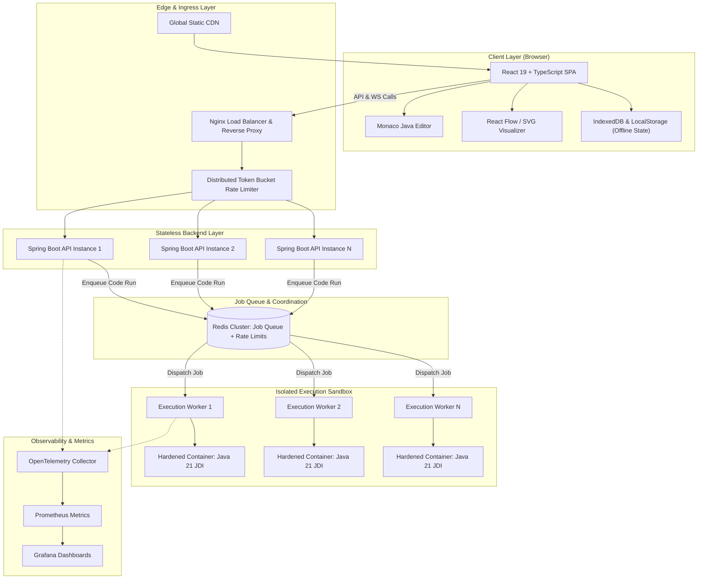

# OOPS LAB — MASTER ARCHITECTURE SPECIFICATION
**Document:** System Architecture & Component Boundaries  
**Status:** Approved Baseline  
**Target:** Java 21 LTS / React 19 / Distributed Cloud  

---

## 1. High-Level Architecture Overview

OOPS LAB is architected as a decoupled, multi-tier, event-driven platform capable of running in single-node development environments (via Docker Compose) and scaling horizontally to handle heavy classroom and enterprise loads (via Kubernetes and queue-based autoscaling).

---

## 2. Core Subsystems & Boundaries

### 2.1 Frontend Workspace Subsystem
- **Boundary:** Runs entirely within the learner's browser.
- **Responsibilities:**
  - Rendering the 3-panel workspace (Editor, Visualizer, Inspector).
  - Deterministic state machine managing playback (Play, Pause, Step Next, Step Prev, Speed).
  - Offline-first persistence via IndexedDB for diagrams, challenges, and code drafts.
  - Converting visual class diagram modifications into Java 21 source code.

### 2.2 Backend Gateway & AST Subsystem
- **Boundary:** Stateless Spring Boot 3.x cluster.
- **Responsibilities:**
  - Curriculum delivery, metadata, problem definitions, reference materials.
  - AST parsing via JavaParser for static structure analysis and class modeling.
  - Security filtering: rejects dangerous imports, reflection, system process spawning before queuing.
  - Job dispatching to the Redis execution queue.

### 2.3 Sandboxed Execution Subsystem
- **Boundary:** Isolated worker pool running disposable execution containers.
- **Responsibilities:**
  - Compiling student code with `javac --release 21`.
  - Attaching Java Debug Interface (JDI) to trace instruction-level state changes.
  - Emitting structured execution events (frame enter/exit, allocation, mutation, pointer updates).
  - Enforcing hard CPU (1 core), memory (256MB), and execution timeout (5000ms) caps.

---

## 3. Communication Protocols

| Channel | Protocol | Payload Type | Purpose |
|---|---|---|---|
| Client → API | HTTPS REST | JSON | Concept queries, challenge retrieval, status |
| Client ↔ API | WebSocket / SSE | Typed Event Stream | Real-time Java execution trace streaming |
| API ↔ Redis | Redis Protocol (RESP) | Serialized Job / Result | Async execution queue & rate-limiting buckets |
| Worker ↔ Sandbox | IPC / JDI Socket | Debug Events | JVM stepping and variable inspection |

---

## 4. Architectural Invariants

1. **Deterministic Execution:** The visualizer never invents runtime behavior. Every frame and pointer rendered reflects actual JVM execution events emitted by the sandbox.
2. **Zero In-Process User Code:** Student code is NEVER executed inside the Spring Boot API server process.
3. **Monochrome Design Compliance:** High contrast, neutral grayscale palette, zero distracting colorful emojis, outline-only monochrome SVG icons.
4. **Local-First Guest Experience:** Unauthenticated learners enjoy instant access; no artificial sign-up walls.

