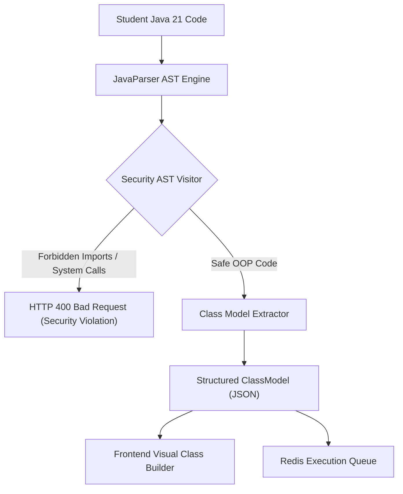

# BACKEND ARCHITECTURE — OOPS LAB
**Framework:** Java 21 LTS + Spring Boot 3.x  
**Parsing Engine:** JavaParser 3.25+  
**Tracing Engine:** JDI (Java Debug Interface) / Bytecode Agent  
**Messaging:** Redis Job Queue (Spring Data Redis)  

---

## 1. System Responsibilities

The backend server operates strictly as a stateless API and coordination gateway:
1. **Curriculum & Content Delivery:** Serving concepts, structured examples, 14-step learning modules, and practice challenges.
2. **Static AST Analysis:** Parsing Java source code using JavaParser to construct class models, validate OOP relationships, and verify student practice challenge assertions.
3. **Security Pre-Screening:** Inspecting AST nodes to reject forbidden classes (`java.lang.reflect`, `java.io.File`, `java.lang.ProcessBuilder`, `java.net.*`) prior to execution.
4. **Job Enqueuing:** Pushing validated code execution jobs onto Redis queues with unique job IDs.
5. **Trace Streaming:** Streaming generated execution events back to the frontend via WebSockets or Server-Sent Events (SSE).

---

## 2. Package Organization

```text
backend/src/main/java/com/oopslab/
├── api/
│   ├── controller/          # REST endpoints (ConceptController, ExecutionController)
│   ├── dto/                 # Request/Response DTOs (RunCodeRequest, AstModelResponse)
│   └── exception/           # Global exception handler & rate-limit error mapping
│
├── parser/
│   ├── service/             # JavaParser wrapper and visitor implementations
│   ├── model/               # ParsedClass, ParsedField, ParsedMethod, ParsedRelation
│   └── validator/           # AST Security Validator (forbidden import detection)
│
├── execution/
│   ├── queue/               # Redis execution job producer and consumer
│   ├── model/               # ExecutionJob, ExecutionResult, ExecutionEvent
│   └── service/             # JobStatusService (polling or SSE push)
│
├── ratelimit/
│   ├── filter/              # Redis token bucket rate limiting servlet filter
│   └── config/              # Tiered policy configurations (IP limits, execution caps)
│
└── config/
    ├── RedisConfig.java     # Redis connection pool & serialization
    ├── SecurityConfig.java  # CORS, headers, anonymous session context
    └── WebConfig.java       # Interceptors and Jackson Java 21 date/time modules
```

---

## 3. Java AST Parsing Architecture (JavaParser)



### Static Analysis Security Filter
Before any code reaches the compiler or execution worker, an AST visitor traverses all imports, method calls, and object instantiations:
- **Disallowed Packages:** `java.io.*` (except `java.io.PrintStream` for `System.out`), `java.net.*`, `java.lang.reflect.*`, `java.lang.instrument.*`, `sun.*`.
- **Disallowed Invocations:** `System.exit()`, `Runtime.getRuntime()`, `ProcessBuilder`, thread pool spawners.
- **Allowed Constructs:** Core language features, primitive types, classes, interfaces, inheritance, polymorphism, records, sealed classes, arrays, collections (`java.util.*`), math, exceptions.

