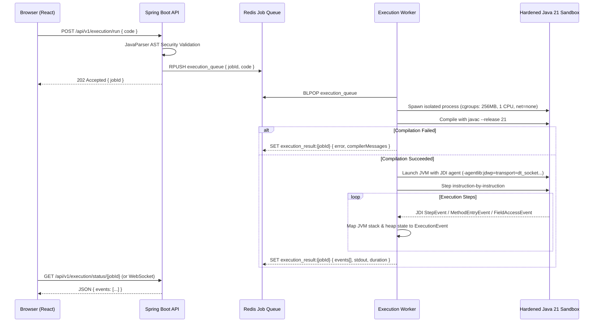

# EXECUTION ENGINE & SANDBOX ARCHITECTURE — OOPS LAB
**Runtime:** Java 21 LTS Isolated Sandbox  
**Inspection:** Java Debug Interface (JDI) Step Tracer  
**Queue:** Redis List / Stream  

---

## 1. Execution Flow & Architecture

The execution engine is responsible for compiling and running student-submitted code safely and extracting deterministic execution events.



---

## 2. Typed Execution Event Schema

Every execution event captured by the worker is serialized into a standard typed JSON format consumed by the frontend visualizer:

```typescript
export type ExecutionEventType = 
  | 'STEP_ENTER'
  | 'FRAME_PUSH'
  | 'FRAME_POP'
  | 'OBJECT_ALLOCATED'
  | 'FIELD_MUTATED'
  | 'STDOUT'
  | 'STDERR'
  | 'EXCEPTION_THROWN'
  | 'EXECUTION_COMPLETED';

export interface ExecutionEvent {
  step: number;
  type: ExecutionEventType;
  line: number;
  methodName: string;
  className: string;
  
  // Call stack state
  stackFrames: {
    frameId: string;
    methodName: string;
    className: string;
    line: number;
    localVariables: {
      name: string;
      type: string;
      value: string | number | boolean | null;
      isReference: boolean;
      targetAddress?: string; // e.g. "@0x1B82"
    }[];
  }[];

  // Heap state
  heapObjects: {
    address: string;          // e.g. "@0x1B82"
    className: string;
    fields: {
      name: string;
      type: string;
      value: string | number | boolean | null;
      isReference: boolean;
      targetAddress?: string;
    }[];
  }[];

  stdout?: string;
  errorMessage?: string;
}
```

---

## 3. Worker Security Constraints & Caps

1. **Memory Ceiling:** 256 MB maximum resident memory per run.
2. **CPU Limit:** 1 virtual core pinned.
3. **Execution Timeout:** 5000 ms wall-clock time limit. Runs exceeding this limit are terminated with a `TIMEOUT_EXCEEDED` event.
4. **Output Limit:** Maximum 64 KB of combined stdout/stderr to prevent buffer-exhaustion attacks.
5. **Network Disabled:** Docker container flag `--network none` or Linux unshare `CLONE_NEWNET`.
6. **Filesystem Sandbox:** Ephemeral overlayfs mount. Filesystem is discarded immediately upon run completion.

