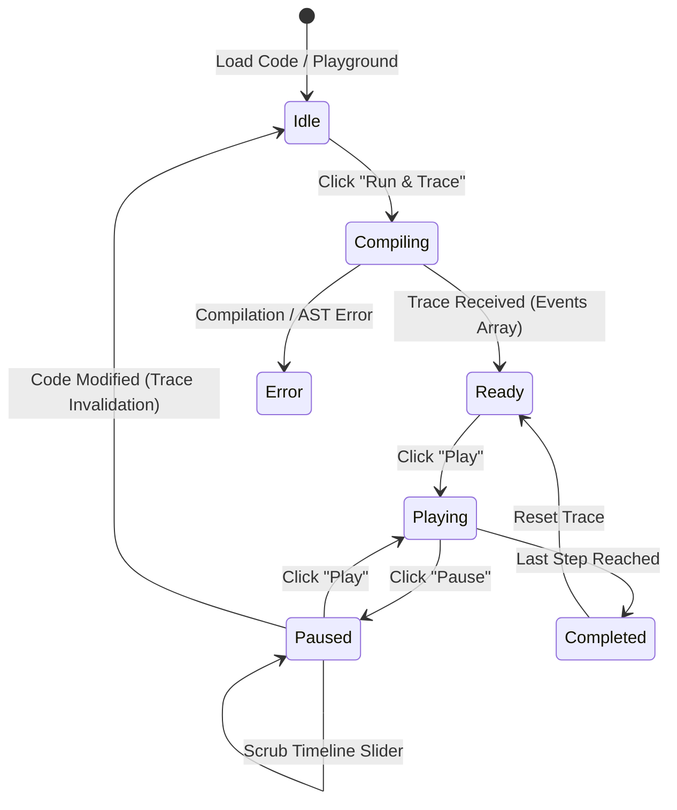

# FRONTEND ARCHITECTURE — OOPS LAB
**Framework:** React 19 + TypeScript + Vite  
**Design System:** Monochrome Light Theme  
**State Architecture:** Event-Driven Deterministic State Machine (Zustand)  

---

## 1. Architectural Principles

1. **Deterministic Visualizer:** The UI never calculates JVM memory state on its own; it projects a sequence of immutable `ExecutionEvent` objects received from the execution engine.
2. **Component Modularity:** Reusable, isolated components with strict separation between presentation, state, and domain logic.
3. **Responsive Density:** Fluid multi-device responsiveness (desktop, tablet, mobile) with consistent outline typography and icons.

---

## 2. Directory & Module Structure

```text
frontend/src/
├── app/
│   ├── routes/              # React Router route definitions
│   ├── layouts/             # AppLayout, WorkspaceLayout, AuthPlaceholderModal
│   └── providers/           # ThemeProvider, ToastProvider, HotkeyProvider
│
├── components/
│   ├── shared/              # Button, Card, Dialog, Badge, Slider, Splitter
│   ├── navigation/          # LeftSidebar, TopHeader, Breadcrumbs, NavLinks
│   └── panels/              # EditorPanel, VisualizerPanel, InspectorPanel
│
├── features/
│   ├── landing/             # Public landing page with hero, features, roadmap
│   ├── dashboard/           # User command center, progress widgets, recommendations
│   ├── concepts/            # Topic index, syllabus browser, concept master view
│   ├── visualizer/          # Heap/Stack visualizer, React Flow canvas, memory graphs
│   ├── playground/          # 3-Panel interactive IDE with step debugger
│   ├── classbuilder/        # Visual OOP class builder with 2-way Java sync
│   ├── practice/            # Challenge explorer, auto-grading assertions
│   └── settings/            # Local preferences, animation speeds, editor keymaps
│
├── engine/
│   ├── events/              # ExecutionEvent types and contracts
│   ├── state/               # Zustand simulation store (play, pause, step, scrub)
│   ├── memory/              # Heap & Stack projection models
│   └── timeline/            # Snapshot indexing and history scrubbing
│
├── services/
│   ├── api/                 # REST client for backend endpoints
│   ├── storage/             # IndexedDB wrapper (Dexie/idb) & LocalStorage
│   └── codegen/             # Visual class model to Java 21 source generator
│
├── types/                   # TypeScript interfaces (Classes, Fields, Methods, UML)
└── styles/                  # Tailwind CSS semantic design tokens
```

---

## 3. Simulation State Machine (Zustand)



### State Store Interface (`simulationStore.ts`)
```typescript
export interface SimulationState {
  code: string;
  events: ExecutionEvent[];
  currentStepIndex: number;
  playbackState: 'idle' | 'compiling' | 'ready' | 'playing' | 'paused' | 'completed' | 'error';
  speed: number; // 0.25x to 4x
  isLooping: boolean;
  activeLine: number | null;
  heapObjects: Map<string, HeapObject>;
  stackFrames: StackFrame[];
  consoleOutput: string[];
  
  // Actions
  setCode: (code: string) => void;
  loadTrace: (events: ExecutionEvent[]) => void;
  play: () => void;
  pause: () => void;
  stepForward: () => void;
  stepBackward: () => void;
  seekToStep: (index: number) => void;
  setSpeed: (speed: number) => void;
  reset: () => void;
}
```

---

## 4. Visualizer Rendering Pipeline (React Flow + SVG)

1. **Step Snapshot:** Given `currentStepIndex`, the engine produces a projection of active `StackFrame`s and referenced `HeapObject`s.
2. **Node Creation:**
   - Stack frame nodes display method name, line number, and local primitive/reference variables.
   - Heap nodes display object type (e.g. `Dog`, `BankAccount`), identity hash/virtual address (e.g. `@0x1A4F`), and instance field values.
3. **Edge Creation:**
   - Reference variables in stack frames point to heap object nodes via bezier curves.
   - Object-to-object references (aggregation, composition) link heap nodes.
4. **Layout:** Deterministic layout with stack frames on the left column and heap space on the right canvas.

---

## 5. Design System Tokens (Tailwind CSS)

```css
:root {
  --background: #FFFFFF;
  --surface: #FAFAFA;
  --card: #FFFFFF;
  --border: #E4E4E7;
  --border-focus: #18181B;
  --foreground: #18181B;
  --muted-foreground: #71717A;
  --accent: #F4F4F5;
  --accent-foreground: #09090B;
  
  /* Memory visualization semantic monochrome shades */
  --stack-frame: #F4F4F5;
  --stack-frame-border: #D4D4D8;
  --heap-object: #FFFFFF;
  --heap-object-border: #18181B;
  --pointer-line: #18181B;
  --active-highlight: #F4F4F5;
}
```

