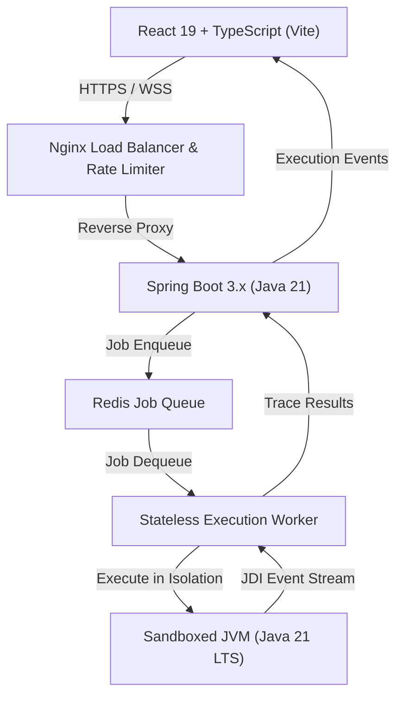

# MASTER SPECIFICATION — OOPS LAB
**Project:** OOPS LAB  
**Central ID:** OOPS-20261030-0001  
**Task ID:** OOPS-20261030-0001-T04  
**Last Updated:** 2026-10-31T00:03:00+05:30  
**Status:** Baseline Established (Living Document)  

---

## 1. Requirement Integrity & Classification Framework

In accordance with Section 2.2 of the Master Development Directives, every requirement in this document is strictly classified into one of four states:
- `CONFIRMED`: Explicitly approved and specified by the user.
- `PROPOSED`: Architecturally designed or suggested by the agent; awaiting confirmation.
- `PENDING`: Awaiting specific user clarification or external syllabus materials.
- `IMPLEMENTED`: Fully developed, tested, and verified in the codebase.

---

## 2. Core Vision & Product Purpose

| Item | Description | Status |
|---|---|---|
| **Mission** | Open-source interactive Java OOP learning and visualization platform designed to eliminate cognitive friction in mastering Object-Oriented Programming. | `CONFIRMED` |
| **Pillar 1: Visual Learning** | High-contrast, deterministic visual representation of JVM heap allocations, stack frames, reference pointers, and OOP relationship graphs. | `CONFIRMED` |
| **Pillar 2: Interactive Coding** | In-browser Monaco editor synchronized with step-by-step JVM execution trace playback. | `CONFIRMED` |
| **Pillar 3: OOP Experimentation** | Visual Class Builder allowing learners to model OOP hierarchies diagrammatically with controlled bidirectional code generation. | `CONFIRMED` |
| **Primary Learner Flow** | Public Landing → Dashboard → Concept Explorer → Learn / Visualize / Practice → Interactive Laboratory. | `CONFIRMED` |

---

## 3. Product Features & Page Matrix

| Route / Page | Purpose & Scope | Status | Notes |
|---|---|---|---|
| **Public Landing Page** | Value proposition, feature showcases, curriculum roadmap preview, interactive teaser demo, CTA to Dashboard. | `CONFIRMED` | Guest access enabled |
| **Dashboard** | Central command hub showing learning path progress, recent visualizations, recommended practice challenges. | `CONFIRMED` | Backed by local storage |
| **Concept Explorer** | Categorized index of all Java 21 OOP concepts with search, filtering, and prerequisite graphs. | `CONFIRMED` | Prerequisite ordering |
| **Visualizers Hub** | Dedicated catalog of interactive visual simulations (Heap vs Stack, Inheritance trees, Polymorphic dispatch). | `CONFIRMED` | Hybrid simulation engine |
| **Java Playground** | Free-form 3-panel workspace: Java Editor + Execution Visualizer + Runtime Inspector. | `CONFIRMED` | Isolated worker backend |
| **Practice Challenges** | Guided problem sets with auto-grading, structural assertions, and visual debugger hints. | `CONFIRMED` | AST & runtime validated |
| **Roadmap** | Visual curriculum graph displaying prerequisite dependencies and mastery milestones. | `CONFIRMED` | Interactive tree |
| **Progress Tracker** | Analytics on topics mastered, exercises solved, and simulation time spent. | `CONFIRMED` | Local-first persistence |
| **Reference Guide** | Cheatsheets, Java 21 syntax reference, JVM memory lifecycle guides, UML quick-reference. | `CONFIRMED` | Searchable reference |
| **About / Manifesto** | Open-source mission, architectural principles, contributor guidelines, attribution. | `CONFIRMED` | OSS documentation |
| **Settings** | Editor configurations (font size, keybindings, tab size), animation speed, accessibility toggles. | `CONFIRMED` | Stored in LocalStorage |
| **Profile** | Local learner profile, milestone badges, export/import progress data. | `CONFIRMED` | Guest mode default |
| **Authentication Modals** | Sign-In / Sign-Up triggers show "Coming Soon" notification. | `CONFIRMED` | Real auth postponed |
| **Incomplete Feature Triggers** | Stubs / future modules show "Additional Features Loading". | `CONFIRMED` | Zero fake forms |

---

## 4. UI/UX & Design System Standards

| Dimension | Specification | Status |
|---|---|---|
| **Theme** | Monochromatic light interface. Crisp, minimalist, sophisticated, and distraction-free. | `CONFIRMED` |
| **Color Palette** | Pure white (`#FFFFFF`), off-white background (`#FAFAFA`), subtle borders (`#E4E4E7`), neutral slate text (`#18181B` / `#71717A`). | `CONFIRMED` |
| **Typography** | Modern sans-serif system fonts with balanced hierarchy. Minimum font size is 12px for maximum legibility. | `CONFIRMED` |
| **Iconography** | Outline-only monochrome icons (Lucide or custom SVG). Zero colorful emojis. | `CONFIRMED` |
| **Animations** | Physics-based micro-interactions (Motion / framer-motion) for node transitions and execution stepping. | `CONFIRMED` |
| **Layout & Density** | Balanced density, mixed corner radii (`rounded-lg` / `rounded-xl`), persistent responsive left sidebar. | `CONFIRMED` |
| **Supplied Components** | User-supplied UI components serve as design ground truth and must be preserved with exact proportions and styling. | `CONFIRMED` |

---

## 5. Curriculum & Learning Model (Java 21)

### 5.1 Curriculum Modules
1. **Java Foundations:** Variables, data types, operators, conditionals, loops, methods, arrays, packages. (`CONFIRMED`)
2. **Core OOP:** Classes, objects, constructors, encapsulation, inheritance, polymorphism, abstraction. (`CONFIRMED`)
3. **Relationships:** Association, aggregation, composition, dependency, UML diagrams. (`CONFIRMED`)
4. **Java-Specific OOP:** `this`, `super`, `static`, `final`, access modifiers, overloading, overriding, static/dynamic binding, interfaces, abstract classes, nested classes, `Object` methods. (`CONFIRMED`)
5. **Advanced OOP Behavior:** Reference casting, `instanceof`, `equals()` and `hashCode()`, cloning, garbage collection cycles, immutability, records, sealed classes, generics. (`CONFIRMED`)
6. **Supporting Topics:** Exception hierarchy, Collections framework, thread concurrency basics, JVM memory structure (heap, stack, metaspace), bytecode fundamentals. (`CONFIRMED`)
7. **University Syllabus Alignment:** Integration with university curriculum structures. (`PENDING` - awaiting syllabus upload)

### 5.2 14-Step Concept Mastery Pedagogical Framework
Every concept follows a standardized 14-step learning structure:
1. Introduction  
2. Prerequisites  
3. Definition  
4. Explanation  
5. Syntax  
6. Examples  
7. Visual Explanation  
8. Interactive Simulation  
9. Code Execution  
10. Internal Behavior (JVM Heap/Stack)  
11. Real-World Applications  
12. Common Mistakes  
13. Practice Challenges  
14. Knowledge Check  
*Status:* `CONFIRMED`

---

## 6. Simulation Engine & 3-Panel Workspace

| Feature | Specification | Status |
|---|---|---|
| **Architecture** | Hybrid simulation architecture with deterministic state machine driven by real JVM execution events. | `CONFIRMED` |
| **Event Stream** | Backend worker emits typed JSON execution trace events (StepEntered, ObjectAllocated, FieldMutated, FramePushed, FramePopped, ExceptionThrown). | `CONFIRMED` |
| **Panel 1: Code Editor** | Monaco editor with Java 21 syntax highlighting, breakpoint markers, and active execution line highlights. | `CONFIRMED` |
| **Panel 2: Interactive Visualizer** | React Flow / SVG canvas rendering memory layout, heap objects with memory addresses, pointer arrows, and class diagrams. | `CONFIRMED` |
| **Panel 3: Execution Inspector** | Call stack viewer, local variable table, event timeline scrub bar, console stdout/stderr monitor. | `CONFIRMED` |
| **Playback Controls** | Play, Pause, Next Step, Prev Step, Speed Slider (0.25x - 4x), Reset, Loop, Timeline Scrubbing, Bookmarks. | `CONFIRMED` |
| **Synchronization Mode** | Step-by-step synchronization. Editing code invalidates running trace and prompts trace rebuild. | `CONFIRMED` |
| **Panel Resizing & Drag** | Configurable layout ratios with draggable splitter bars. | `PROPOSED` |

---

## 7. Interactive Class Builder

| Capability | Specification | Status |
|---|---|---|
| **Visual Modeling** | Create/edit classes, fields, methods, constructors, access modifiers, data types, static/final flags, inheritance parents, implemented interfaces. | `CONFIRMED` |
| **Bidirectional Sync** | Controlled two-way sync: Visual updates immediately generate Java 21 code; manual code edits require explicit sync action. | `CONFIRMED` |
| **Static Parsing** | JavaParser inspects manually modified code, detects syntax errors, flags unsupported constructs, and prompts user before overwriting diagram. | `CONFIRMED` |
| **Conflict Resolution** | Explicit diff comparison modal when code changes diverge from visual diagram. | `PROPOSED` |

---

## 8. Technical Architecture & Technology Stack

| Component | Selected Technology | Rationale | Status |
|---|---|---|---|
| **Frontend Framework** | React 19 + TypeScript | Type safety, performance, ecosystem. | `CONFIRMED` |
| **Build Tooling** | Vite | Ultra-fast HMR and optimized asset bundling. | `CONFIRMED` |
| **Styling** | Tailwind CSS | Utility-first, semantic monochrome variables. | `CONFIRMED` |
| **Animations** | Motion (framer-motion) | Smooth physics-based state transitions. | `CONFIRMED` |
| **Diagram Engine** | React Flow + Custom SVG | Node-based graph visualization for heap/stack. | `CONFIRMED` |
| **Code Editor** | Monaco Editor | VS Code editor core with Java language features. | `CONFIRMED` |
| **State Management** | Zustand | Lightweight deterministic state store. | `CONFIRMED` |
| **Client Storage** | IndexedDB & LocalStorage | Offline-first, guest session persistence. | `CONFIRMED` |
| **Backend Framework** | Java 21 LTS + Spring Boot 3.x | Enterprise-grade REST APIs and validation. | `CONFIRMED` |
| **AST Parser** | JavaParser | Static code analysis and class model generation. | `CONFIRMED` |
| **JVM Debugger** | JDI (Java Debug Interface) | Deterministic instruction-level trace capture. | `CONFIRMED` |
| **Job Queue & Rate Limiter** | Redis | High-throughput async dispatch and token bucket. | `CONFIRMED` |
| **Container Runtime** | Docker / Docker Compose | Reproducible sandboxed execution worker. | `CONFIRMED` |
| **Knowledge Graph** | Graphify (`.graphify/`) | Project-scoped AI context layer. | `IMPLEMENTED` |

---

## 9. Scalable Infrastructure & Security Boundaries

### 9.1 Security & Sandbox Boundary
1. **Zero Direct Execution:** Student code is never compiled or executed inside the primary Spring Boot API server. (`CONFIRMED`)
2. **Resource Constraints:** Disposable execution workers with strict cgroup limits:
   - Memory Cap: 256MB
   - CPU Cap: 1 core
   - Execution Timeout: 5000ms
   - Output Cap: 64KB stdout/stderr
   - Network Access: Completely disabled (`--network none`)
   - Filesystem Access: Read-only root filesystem with ephemeral `/tmp` volume (`CONFIRMED`)
3. **AST Validation:** JavaParser filters disallowed imports (e.g., `java.lang.reflect`, `java.net.*`, `java.io.File`, `java.lang.ProcessBuilder`) before queuing jobs. (`CONFIRMED`)

### 9.2 Rate Limiting Policies (Redis Token Bucket)
- **Static Content:** High limit (120 req/min/IP). (`CONFIRMED`)
- **Read-Only API:** Standard limit (60 req/min/IP). (`CONFIRMED`)
- **Interactive Simulations:** Cached state requests (60 req/min/IP). (`CONFIRMED`)
- **Java Compilation & Execution:** Strict limit (10 req/min/IP, 2 concurrent per IP). (`CONFIRMED`)
- **Response Headers:** `Retry-After`, `X-RateLimit-Limit`, `X-RateLimit-Remaining`. (`CONFIRMED`)

### 9.3 Horizontal Autoscaling Architecture
- **API Instances:** Scaled dynamically based on CPU utilization (>70%) and HTTP response latency (>250ms). (`CONFIRMED`)
- **Execution Workers:** Scaled independently based on Redis queue depth (>15 pending jobs) and oldest waiting job age (>3000ms). (`CONFIRMED`)
- **Development Environment:** Docker Compose single-node setup with mock or local Redis. (`CONFIRMED`)
- **Production Environment:** Kubernetes with HPA for API pods and KEDA queue-based scaling for execution workers. (`CONFIRMED`)

---

## 10. Audit, Rollback & Governance Standards

| Requirement | Implementation | Status |
|---|---|---|
| **Unique Central ID** | Every user request receives `OOPS-YYYYMMDD-XXXX`. | `IMPLEMENTED` |
| **Task Decomposition** | Child tasks receive `OOPS-YYYYMMDD-XXXX-TYY`. | `IMPLEMENTED` |
| **Chronological Audit Log** | Permanent record in `docs/project/ledger/MASTER_ACTIVITY_LOG.md`. | `IMPLEMENTED` |
| **File Modification Register** | Detailed change logging in `docs/project/ledger/FILE_CHANGE_REGISTER.md`. | `IMPLEMENTED` |
| **Task Records** | Detailed records in `docs/project/ledger/records/`. | `IMPLEMENTED` |
| **Rollback Index** | Checkpoints mapped in `docs/project/ledger/ROLLBACK_INDEX.md`. | `IMPLEMENTED` |
| **Test History** | Verifications logged in `docs/project/ledger/TEST_HISTORY.md`. | `IMPLEMENTED` |
| **Streamlined Operational Directive** | Comprehensive logging maintained; Git commits batched at major milestones; skills bypassed. | `IMPLEMENTED` |
| **Knowledge Graph Protocol** | Graphify local graph inspection before code edits. | `IMPLEMENTED` |

---
*End of Master Specification.*

